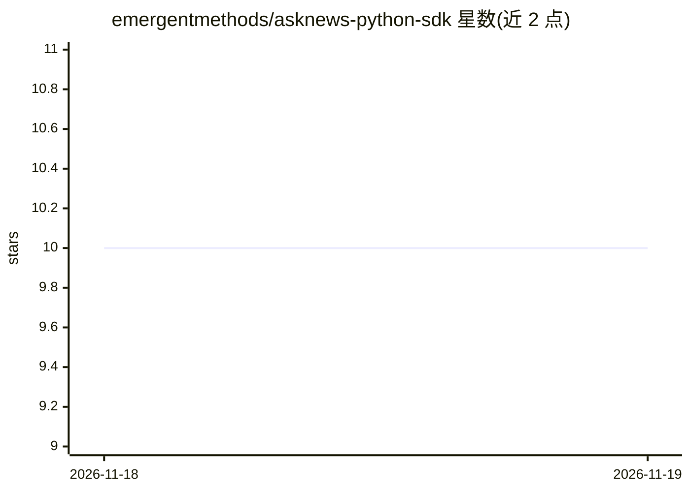

# emergentmethods/asknews-python-sdk

⭐ 10 · Python · MIT · 推送 2026-11-18 · [GitHub](https://github.com/emergentmethods/asknews-python-sdk) · [官网](https://docs.asknews.app) · 组织维护

**一行代码把新闻接入任意 LLM 的 Python SDK**

AskNews API 的官方 Python SDK，支持 Python 3.10–3.14，通过 pip 安装。提供两类新闻检索接口：基于关键词/实体的单次 search_news 查询，以及 DeepNews 深度研究代理，可跨新闻、知识图谱、X、Reddit、Google、Wikipedia 等来源迭代检索，产出预测、报告与分析。另有 /websearch（网页内容 LLM 蒸馏）、/wikipedia（Wikipedia 语料检索）、/stories（事件跟踪与文章聚类）等端点，配套 Cookbook 与在线文档。使用需连接 AskNews API 服务。

## 筛选速览

| 维度 | 判定 | 备注 |
|---|---|---|
| AI 角色 | `ai-ecosystem` | LLM/agent 周边工具 |
| 许可风险 | `permissive` | MIT |
| 部署形态 | `library` | 以包/库形式分发 |
| 模型依赖 | — | README 未给出锁定关系 |
| 硬件要求 | — | 无带数字的原话,不猜 |
| 安装摩擦 | `low` | 无编译、无系统依赖或容器化 |
| 成熟度 | — | 结构信号不足 |

## 能力要点

- search_news 单次检索与 DeepNews 迭代式深度研究两种模式
- DeepNews 可探索知识图谱、X、Reddit、Google、Wikipedia 等多源
- /stories 提供事件跟踪与文章聚类
- 提供 Cookbook 与完整 API 文档

## 适用场景

- 为 RAG 系统补充实时新闻语料
- 构建需要追踪事件与线索的预测或报告 agent
- 在应用中做 Wikipedia 与网页检索的 LLM 蒸馏

## 场景标签

`RAG` · 领域:知识与检索

## 证据(README 行号)

> L5: Python SDK for the AskNews API.
> L20: - Use DeepNews (`ask.chat.get_deep_news()` in this SDK) to attach your agent to deep, iterative research across new

## 星数曲线

2026-11-18 10 → 2026-11-19 10（+0）

---
*卡片 v1 · prompt 1.4 · 生成 2026-11-19 · 置信度 high · 依据 README sha `19e8fae122e1` · [字段定义](../../DATASET.md)*
