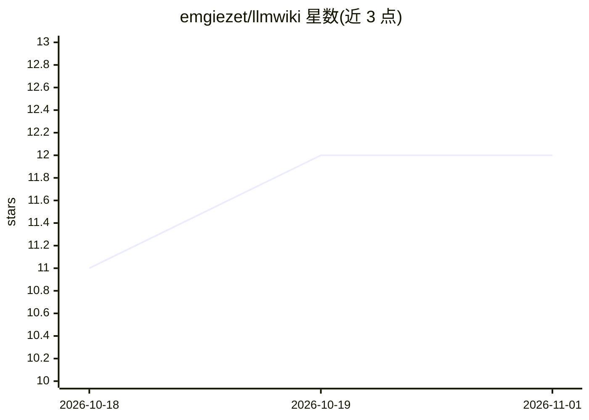

# emgiezet/llmwiki

⭐ 12 · Go · MIT · 推送 2026-10-19 · [GitHub](https://github.com/emgiezet/llmwiki) · 个人维护

**把代码库生成 LLM 维护的 markdown wiki，供 AI agent 经 MCP 读取**

用 Go 编写的本地文档工具：ingest 扫描代码库，借助 LLM 后端（Claude Code 订阅、Claude API 或本地 Ollama）生成含架构图、服务图、集成图的纯 markdown wiki；`llmwiki mcp` 以 MCP server 形式向 Claude Code、Cursor 等 agent 客户端提供提取的领域/服务/流程信息，查询过程无 LLM 调用。支持漂移检测（llmwiki check）、知识分层、多项目索引与 PDF/DOCX/EPUB 文档提取。面向维护多客户代码库的顾问、技术负责人和开发者。

## 筛选速览

| 维度 | 判定 | 备注 |
|---|---|---|
| AI 角色 | `ai-ecosystem` | LLM/agent 周边工具 |
| 许可风险 | `permissive` | MIT |
| 部署形态 | `self-host` | docker 或自建部署 |
| 模型依赖 | local-ok | 支持本地模型 |
| 硬件要求 | — | 无带数字的原话,不猜 |
| 安装摩擦 | `low` | 无编译、无系统依赖或容器化 |
| 成熟度 | — | 结构信号不足 |

## 能力要点

- ingest 扫描 docker-compose.yml 与代码指标，按服务生成 markdown wiki 与 Mermaid 图
- MCP server 供 agent 免 LLM 调用查询提取结果
- 三种 LLM 后端：Claude Code 订阅 / Claude API / 本地 Ollama
- llmwiki check 追踪源文件与条目的漂移并标记过期

## 适用场景

- 我不想每个会话都向 AI 助手重新解释仓库结构
- 维护多个客户代码库时保持文档与代码同步
- NDA 项目下用本地 Ollama 模型生成文档，代码不出本机

## 场景标签

`知识库管理` · 领域:知识与检索

## 证据(README 行号)

> L15: **Your AI agents read it directly over MCP** — `llmwiki mcp` serves every project's extracted domain, services, and
> L51: - **MCP server for agents** — agents query the extracted wiki over stdio (`llmwiki mcp`), filtered by client/projec

## 星数曲线

2026-10-18 11 → 2026-11-01 12（+1）

---
*卡片 v1 · prompt 1.4 · 生成 2026-11-01 · 置信度 high · 依据 README sha `425512aec850` · [字段定义](../../DATASET.md)*
