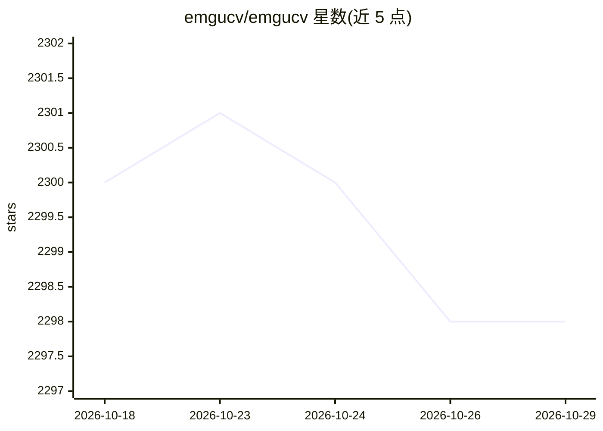

# emgucv/emgucv

⭐ 2,298 · C# · NOASSERTION · 推送 2026-10-22 · [GitHub](https://github.com/emgucv/emgucv) · [官网](https://www.emgu.com/) · 组织维护

**OpenCV 的跨平台 .NET 绑定封装库**

将 C++ 图像处理库 OpenCV 封装为 .NET 可调用的接口，使 C# 等 .NET 语言能够调用 OpenCV 函数。封装层可通过 Visual Studio、Unity 和 dotnet 命令编译，运行平台覆盖 Windows、macOS、Linux、iOS 与 Android，并支持 MAUI 移动开发场景。README 仅包含项目简介与指向官网的构建安装文档链接，详细文档在外部 wiki。

## 筛选速览

| 维度 | 判定 | 备注 |
|---|---|---|
| AI 角色 | `ai-ecosystem` | LLM/agent 周边工具 |
| 许可风险 | `none` | NOASSERTION |
| 部署形态 | `None` |  |
| 模型依赖 | — | README 未给出锁定关系 |
| 硬件要求 | — | 无带数字的原话,不猜 |
| 安装摩擦 | `medium` | 含编译或系统依赖之一 |
| 成熟度 | — | 结构信号不足 |

## 能力要点

- 从 .NET 兼容语言调用 OpenCV 函数
- 支持 Windows/macOS/Linux/iOS/Android 六个平台
- 可用 Visual Studio、Unity 与 dotnet 命令编译

## 适用场景

- 在 C#/.NET 项目中使用 OpenCV 图像处理能力
- 构建跨平台（含移动端 MAUI）的视觉应用
- Unity 项目中集成 OpenCV 功能

## 场景标签

`图像视频处理` · 领域:感知与多模态

## 证据(README 行号)

> L1: A cross platform .Net wrapper for the Open CV image-processing library. Allows Open CV functions to be called from .

## 星数曲线

2026-10-18 2,300 → 2026-10-29 2,298（-2）

---
*卡片 v1 · prompt 1.4 · 生成 2026-10-21 · 置信度 mid · 依据 README sha `ec19e4e088bc` · [字段定义](../../DATASET.md)*
