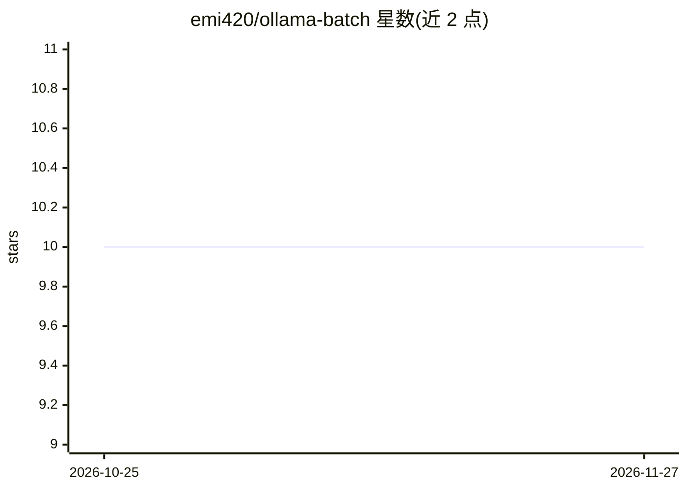

# emi420/ollama-batch

⭐ 10 · Python · AGPL-3.0 · 推送 2026-02-16 · [GitHub](https://github.com/emi420/ollama-batch) · 个人维护

**批量运行 LLM 提示对文本/图片分类的 CLI 工具**

一个命令行工具，对一组文本或图片批量运行 LLM 提示进行分类，以 JSON 输出结果。依赖系统中已安装的 Ollama，默认模型为 gemma3:4b，可通过 -m 参数更换模型。支持从 JSON 文件或目录读取输入、用提示文件、指定 JSON 属性名与追加字段，支持图片输入模式。采用 GNU AGPL-3.0 许可，通过 pip 安装。

## 筛选速览

| 维度 | 判定 | 备注 |
|---|---|---|
| AI 角色 | `ai-native` | 本体是模型或模型工具 |
| 许可风险 | `viral` | AGPL-3.0 |
| 部署形态 | `library` | 以包/库形式分发 |
| 模型依赖 | local-ok | 支持本地模型 |
| 硬件要求 | — | 无带数字的原话,不猜 |
| 安装摩擦 | `low` | 无编译、无系统依赖或容器化 |
| 成熟度 | — | 结构信号不足 |

## 能力要点

- 对文本或图片列表批量运行提示并输出 JSON 分类结果
- 默认模型 gemma3:4b，可用 -m 参数更换任意模型
- 支持 JSON 文件或目录两种输入方式，图片经 -i 开关处理
- 支持提示文件与自定义 JSON 属性/追加字段

## 适用场景

- 批量判断一批文本属于哪一类别
- 对目录下图片逐个运行提示词做分类
- 为每条记录提取自定义 JSON 字段

## 场景标签

 · 领域:数据处理/LLM 工具

## 证据(README 行号)

> L3: This simple utility will runs LLM prompts over a list of texts
> L4: or images for classify them, printing the results as a JSON response.
> L10: You'll need Ollama installed in your system.

## 星数曲线

2026-10-25 10 → 2026-11-27 10（+0）

---
*卡片 v1 · prompt 1.4 · 生成 2026-11-19 · 置信度 high · 依据 README sha `8e7b18aa1a50` · [字段定义](../../DATASET.md)*
