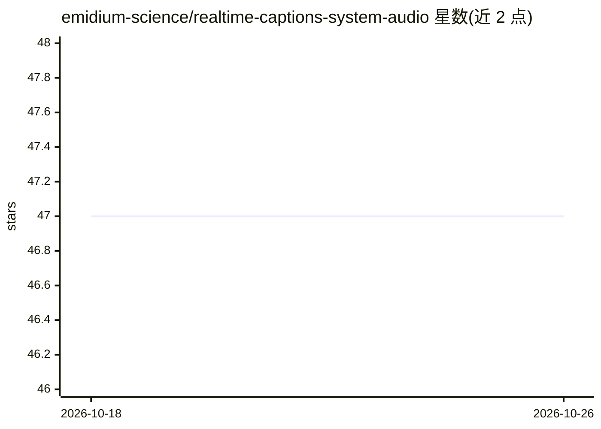

# emidium-science/realtime-captions-system-audio

⭐ 47 · Python · 推送 2026-03-27 · [GitHub](https://github.com/emidium-science/realtime-captions-system-audio) · 个人维护

**Windows 11 系统音频实时字幕工具：Whisper 本地转写**

面向 Windows 11 用户的实时字幕应用：通过 WASAPI loopback 捕获系统播放的音频（会议、视频、通话），经 OpenAI Whisper（经 RealtimeSTT）本地转写，输出部分文本实时预览与稳定终稿；提供悬浮字幕窗口、全屏终端 UI、带时间戳的 txt 转写保存与 GPU/CPU 资源监控。完全离线运行，支持 CUDA 加速或 CPU 回退，可选 tiny.en 到 large-v2 多档模型。仅支持 Windows 11，需 Python 3.11+，两步向导式配置。

## 筛选速览

| 维度 | 判定 | 备注 |
|---|---|---|
| AI 角色 | `ai-native` | 本体是模型或模型工具 |
| 许可风险 | `none` | — |
| 部署形态 | `library` | 以包/库形式分发 |
| 模型依赖 | — | README 未给出锁定关系 |
| 硬件要求 | — | 无带数字的原话,不猜 |
| 安装摩擦 | `medium` | 含编译或系统依赖之一 |
| 成熟度 | — | 结构信号不足 |

## 能力要点

- WASAPI loopback 捕获系统音频，无需麦克风或虚拟声卡
- 双层模型：实时预览 + 高精度终稿转写，模型可从 tiny.en 到 large-v2 选择
- 置顶可点击穿透的悬浮字幕窗口
- 完全本地运行，转写以带时间戳 txt 保存

## 适用场景

- 英文会议/通话中实时看字幕辅助听懂
- 看无字幕外语视频时获得即时字幕
- 保存会议/课程带时间戳的文字记录
- 嘈杂环境或听力不便场景下的离线字幕辅助

## 场景标签

`语音识别` · 领域:感知与多模态

## 证据(README 行号)

> L20: Powered by OpenAI Whisper via RealtimeSTT.
> L21: Captures whatever your computer plays through **WASAPI loopback** — meetings, videos, podcasts, calls — and shows l

## 星数曲线

2026-10-18 47 → 2026-10-26 47（+0）

---
*卡片 v1 · prompt 1.4 · 生成 2026-10-25 · 置信度 mid · 依据 README sha `9eef168f5c1e` · [字段定义](../../DATASET.md)*
