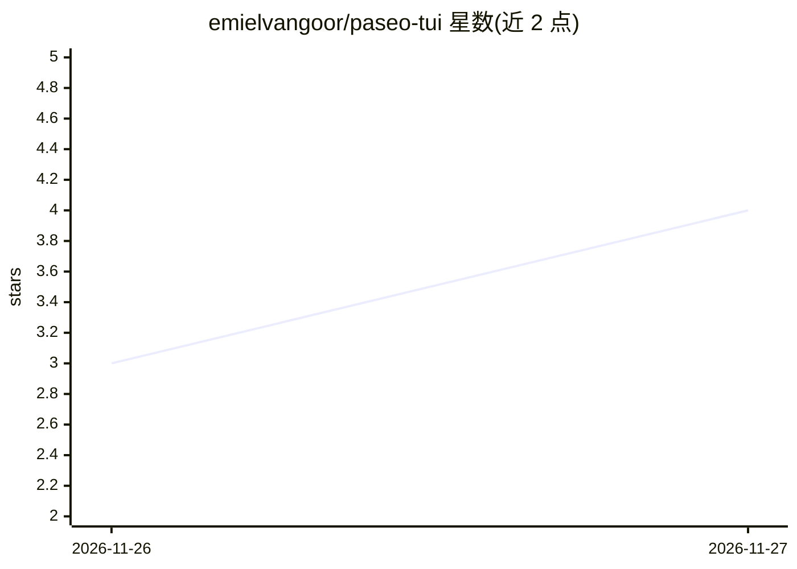

# emielvangoor/paseo-tui

⭐ 4 · Go · Apache-2.0 · 推送 2026-11-26 · [GitHub](https://github.com/emielvangoor/paseo-tui) · 个人维护

**在终端运行并操控 Paseo 编码代理的键盘优先 TUI 客户端**

基于 Go 与 Bubble Tea 构建的 Paseo 终端客户端，复用桌面版的 projects→workspaces→agent tabs 模型：侧边栏按项目/工作区组织代理标签页，实时流式展示代理状态、转录、工具权限与子代理；支持在会话中途切换模型与思考级别、fork 代理、粘贴图片、内置命令面板模糊搜索。通过内嵌的 JavaScript bridge 与本地或远程 Paseo daemon 通信，依赖 Paseo daemon 才能运行。提供 macOS/Linux/Windows 自包含二进制。声明为独立社区构建客户端，与 Paseo 项目无隶属关系。

## 筛选速览

| 维度 | 判定 | 备注 |
|---|---|---|
| AI 角色 | `ai-ecosystem` | LLM/agent 周边工具 |
| 许可风险 | `permissive` | Apache-2.0 |
| 部署形态 | `desktop` | 安装包/桌面程序 |
| 模型依赖 | — | README 未给出锁定关系 |
| 硬件要求 | — | 无带数字的原话,不猜 |
| 安装摩擦 | `low` | 无编译、无系统依赖或容器化 |
| 成熟度 | — | 结构信号不足 |

## 能力要点

- 实时流式展示代理状态、转录与权限，无轮询
- 单自包含二进制，覆盖 macOS/Linux/Windows (arm64/amd64)
- fork 代理可从聊天历史开启新标签页或工作区
- 通过 NDJSON stdio + WebSocket 与本地/远程 daemon 通信

## 适用场景

- 在终端内同时管理多个项目下的 AI 编码代理
- 通过 SSH 或网络连接远程 Paseo daemon 操控代理
- 键盘优先工作流下审查代理的工具调用与权限请求

## 场景标签

`编码 Agent` · 领域:编码与开发

## 证据(README 行号)

> L13: Paseo runs AI coding agents (Claude Code, Codex, Copilot, OpenCode, Oh My Pi, and more) in isolated workspaces
> L15: away. paseo-tui gives you the desktop app's model (**projects → workspaces → agent tabs**) as a snappy TUI.

## 星数曲线

2026-11-26 3 → 2026-11-27 4（+1）

---
*卡片 v1 · prompt 1.4 · 生成 2026-11-26 · 置信度 high · 依据 README sha `19a5bd1837a1` · [字段定义](../../DATASET.md)*
