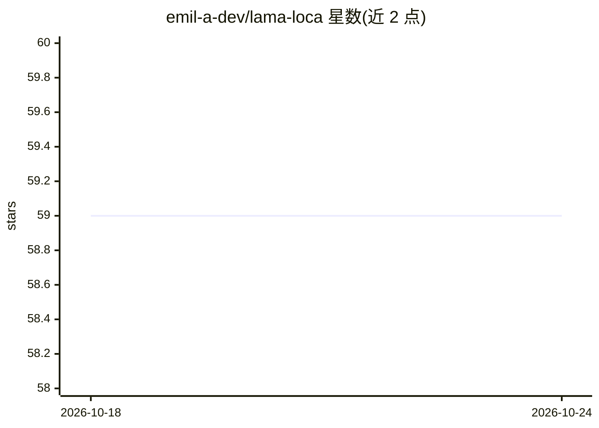

# emil-a-dev/lama-loca

⭐ 59 · Python · MIT · 推送 2026-03-04 · [GitHub](https://github.com/emil-a-dev/lama-loca) · 个人维护

**离线学习 AI 助手：基于自有教材生成报告、演示与笔记**

面向学生的本地 RAG 应用：导入 PDF/EPUB/DOCX/FB2 等教材并索引，随后在聊天中提问（流式回答），或生成学术报告（DOCX+MD）、10-15 页 PPTX 演示、笔记、论文、考题与速查表。技术栈为 Qwen2.5 GGUF 模型（经 llama-cpp-python 加载，最大 32B、上下文 32768）、E5-Large 多语言嵌入、Cross-Encoder 重排与 ChromaDB 向量库，Gradio 网页界面，默认全部离线运行；setup.sh 检测 RAM 推荐模型，默认 GPU 加载，可切纯 CPU。

## 筛选速览

| 维度 | 判定 | 备注 |
|---|---|---|
| AI 角色 | `ai-native` | 本体是模型或模型工具 |
| 许可风险 | `permissive` | MIT |
| 部署形态 | `library` | 以包/库形式分发 |
| 模型依赖 | local-ok | 支持本地模型 |
| 硬件要求 | — | 无带数字的原话,不猜 |
| 安装摩擦 | `medium` | 含编译或系统依赖之一 |
| 成熟度 | — | 结构信号不足 |

## 能力要点

- 本地 RAG：索引自有教材后问答与生成多种学术文档
- 支持 Qwen2.5 3B-32B GGUF（Q4_K_M）本地模型，setup.sh 按 RAM 推荐
- Cross-Encoder 重排（15→8）与 32768 token 上下文
- Gradio 网页界面，数据不离开本机

## 适用场景

- 把课程教材导入后提问并复习备考
- 基于自己的书自动生成报告、演示和笔记
- 在无网络/数据不出本机的环境下使用 AI 学习助手

## 场景标签

`AI 助手` `RAG` `文档问答` · 领域:对话与助手

## 证据(README 行号)

> L10: **Загрузи свои учебники → Получи отчёты, презентации, конспекты и ответы на вопросы**
> L18: |💬|**Чат**|Задавайте вопросы по книгам — ответы в реальном времени (стриминг)|
> L71: |🤖 **LLM**|Qwen2.5 до 32B (GGUF, квантизация Q4_K_M)|Генерация текста на уровне коммерческих моделей|

## 星数曲线

2026-10-18 59 → 2026-10-24 59（+0）

---
*卡片 v1 · prompt 1.4 · 生成 2026-10-24 · 置信度 mid · 依据 README sha `ba7e165fd4d9` · [字段定义](../../DATASET.md)*
