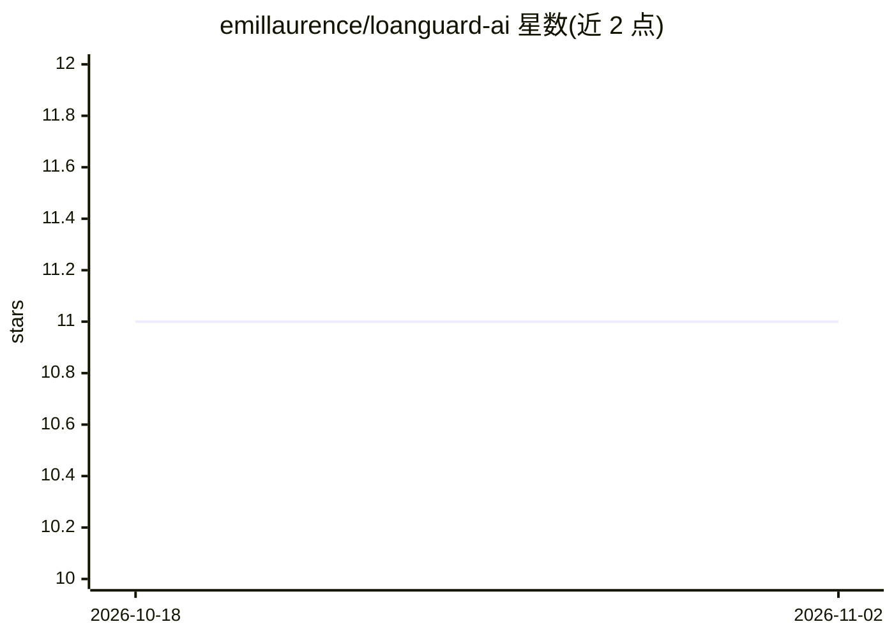

# emillaurence/loanguard-ai

⭐ 11 · Python · Apache-2.0 · 推送 2026-06-05 · [GitHub](https://github.com/emillaurence/loanguard-ai) · 个人维护

**澳大利亚贷款合规监测的 Agentic GraphRAG 系统**

面向澳金融机构合规官与风险分析师的多智能体系统：通过自然语言提问，对贷款申请与借款人做 APRA 审慎标准（APS-112、APG-223、APS-220）阈值核查与金融犯罪风险信号识别。核心机制为三层 Neo4j 知识图谱（实体层/法规层/评估层）与 Orchestrator→ComplianceAgent→InvestigationAgent 的 Claude 流水线，评估结果连同推理链与引用法规条款持久化到图谱，可在 Streamlit 面板中交互追溯证据。依赖 Claude API、OpenAI Embeddings 与 Neo4j AuraDB，数据管线通过 Jupyter notebooks 依次运行。

## 筛选速览

| 维度 | 判定 | 备注 |
|---|---|---|
| AI 角色 | `ai-native` | 本体是模型或模型工具 |
| 许可风险 | `permissive` | Apache-2.0 |
| 部署形态 | `library` | 以包/库形式分发 |
| 模型依赖 | locked-api |  |
| 硬件要求 | — | 无带数字的原话,不猜 |
| 安装摩擦 | `low` | 无编译、无系统依赖或容器化 |
| 成熟度 | — | 结构信号不足 |

## 能力要点

- 三层知识图谱：实体/法规/评估，Jurisdiction 桥接跨层遍历
- Claude 多智能体流水线：意图路由→阈值核查→图遍历异常检测→综合
- 评估结果持久化含完整推理链与引用法规条款，可交互式证据追溯
- 6 种异常检测模式（交易拆分、高 LVR、多层股权等）

## 适用场景

- 合规官用自然语言查询贷款是否符合 APRA 标准
- 风险分析师调查金融犯罪信号（AML 敏感行业、高危辖区）
- 审计团队追溯合规判定的证据链与引用条款

## 场景标签

`多智能体` `知识图谱` `RAG` · 领域:Agent 开发

## 证据(README 行号)

> L7: LoanGuard AI is an agentic AI system for Australian financial services compliance. It checks whether loan applicatio
> L9: The system is designed for compliance officers and risk analysts who need explainable, evidence-backed verdicts rath

## 星数曲线

2026-10-18 11 → 2026-11-02 11（+0）

---
*卡片 v1 · prompt 1.4 · 生成 2026-11-02 · 置信度 mid · 依据 README sha `eeff4b825654` · [字段定义](../../DATASET.md)*
