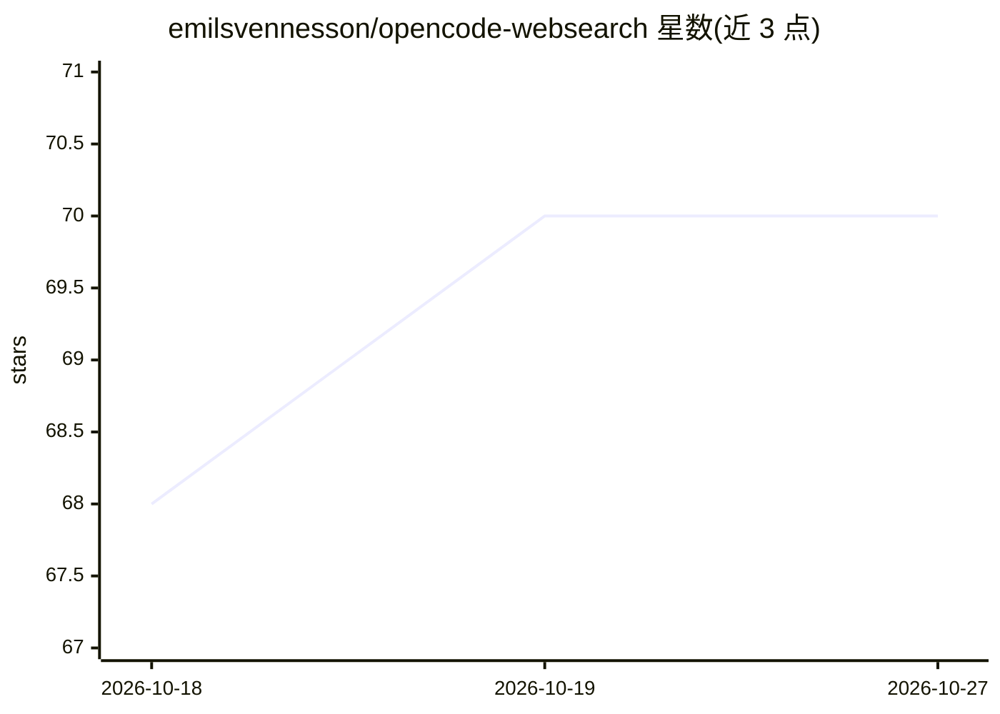

# emilsvennesson/opencode-websearch

⭐ 70 · TypeScript · MIT · 推送 2026-10-25 · [GitHub](https://github.com/emilsvennesson/opencode-websearch) · 个人维护

**为 OpenCode 提供原生网页搜索的插件，复用模型自带搜索能力**

OpenCode 编码代理的插件：注册 web-search 工具，调用模型内置的网页搜索能力完成联网查询，不依赖额外搜索服务或 API key。支持 Anthropic、Moonshot (Kimi)、OpenAI/ChatGPT、GitHub Copilot、xAI (Grok) 五类已在 OpenCode 配置的 provider，搜索能力是否可用取决于具体模型。可通过 opencode.json 的 plugin 数组安装，可选 websearch 标签指定固定或回退模型。开发使用 Bun，从源码以 symlink 方式加载。

## 筛选速览

| 维度 | 判定 | 备注 |
|---|---|---|
| AI 角色 | `ai-ecosystem` | LLM/agent 周边工具 |
| 许可风险 | `permissive` | MIT |
| 部署形态 | `None` |  |
| 模型依赖 | locked-api |  |
| 硬件要求 | — | 无带数字的原话,不猜 |
| 安装摩擦 | `low` | 无编译、无系统依赖或容器化 |
| 成熟度 | — | 结构信号不足 |

## 能力要点

- 复用模型内置网页搜索能力，无需额外搜索服务或 API key
- 支持 Anthropic/Moonshot/OpenAI/GitHub Copilot/xAI 五类 provider
- 可选 websearch 标签配置固定或回退搜索模型

## 适用场景

- 在 OpenCode 中查询最新技术版本等联网信息
- 无额外搜索 API 配置时为编码代理补充网页搜索

## 场景标签

 · 领域:开发者工具/编码代理插件

## 证据(README 行号)

> L3: Native web search for OpenCode, powered by your model's built-in search capability. No extra API keys or search serv
> L37: Add the plugin to your `opencode.json` and OpenCode will install it automatically on startup.

## 星数曲线

2026-10-18 68 → 2026-10-27 70（+2）

---
*卡片 v1 · prompt 1.4 · 生成 2026-10-24 · 置信度 high · 依据 README sha `8119576f6001` · [字段定义](../../DATASET.md)*
