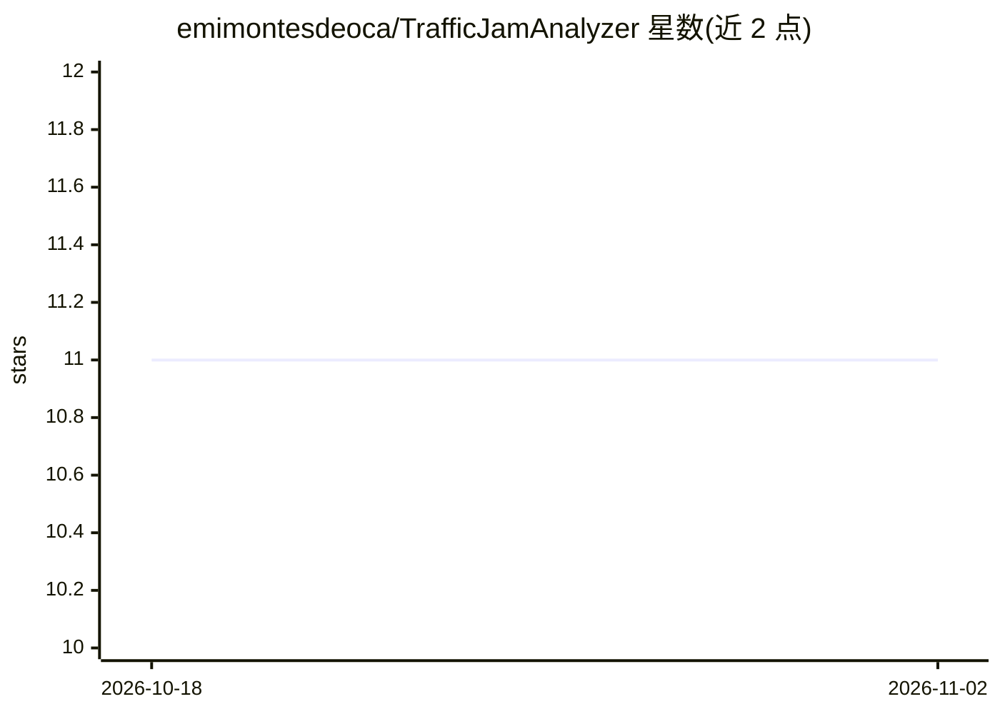

# emimontesdeoca/TrafficJamAnalyzer

⭐ 11 · C# · MIT · 推送 2026-04-30 · [GitHub](https://github.com/emimontesdeoca/TrafficJamAnalyzer) · 个人维护

**用 AI 分析特内里费道路 CCTV 画面、监测交通拥堵的应用**

基于 .NET 8 的交通监测应用：读取特内里费道路周边 CCTV 摄像头图像，通过 Semantic Kernel 调用 OpenAI 评估交通密度并识别潜在拥堵位置，结果在仪表盘中展示。提供道路与区域的可配置设置，要求 Windows 10 以上、访问 OpenAI API key 及本地 CCTV 视频源。安装方式为 git clone 后 dotnet restore/build/run，项目拆分为 ApiService、AppHost、AiApiService 等模块。

## 筛选速览

| 维度 | 判定 | 备注 |
|---|---|---|
| AI 角色 | `ai-native` | 本体是模型或模型工具 |
| 许可风险 | `permissive` | MIT |
| 部署形态 | `None` |  |
| 模型依赖 | — | README 未给出锁定关系 |
| 硬件要求 | — | 无带数字的原话,不猜 |
| 安装摩擦 | `medium` | 含编译或系统依赖之一 |
| 成熟度 | — | 结构信号不足 |

## 能力要点

- 实时分析 CCTV 交通画面
- Semantic Kernel + OpenAI 的拥堵检测
- 可配置道路与区域设置
- 仪表盘展示拥堵位置

## 适用场景

- 监测城市道路拥堵状况
- 通过摄像头画面识别潜在堵点

## 场景标签

`图像视频处理` · 领域:感知与多模态

## 证据(README 行号)

> L3: TrafficJamAnalyzer is an advanced tool designed to help monitor and analyze traffic conditions by processing images 
> L10: - AI-based detection for traffic jams using Semantic Kernel and OpenAI.

## 星数曲线

2026-10-18 11 → 2026-11-02 11（+0）

---
*卡片 v1 · prompt 1.4 · 生成 2026-11-02 · 置信度 high · 依据 README sha `77afab8e6995` · [字段定义](../../DATASET.md)*
