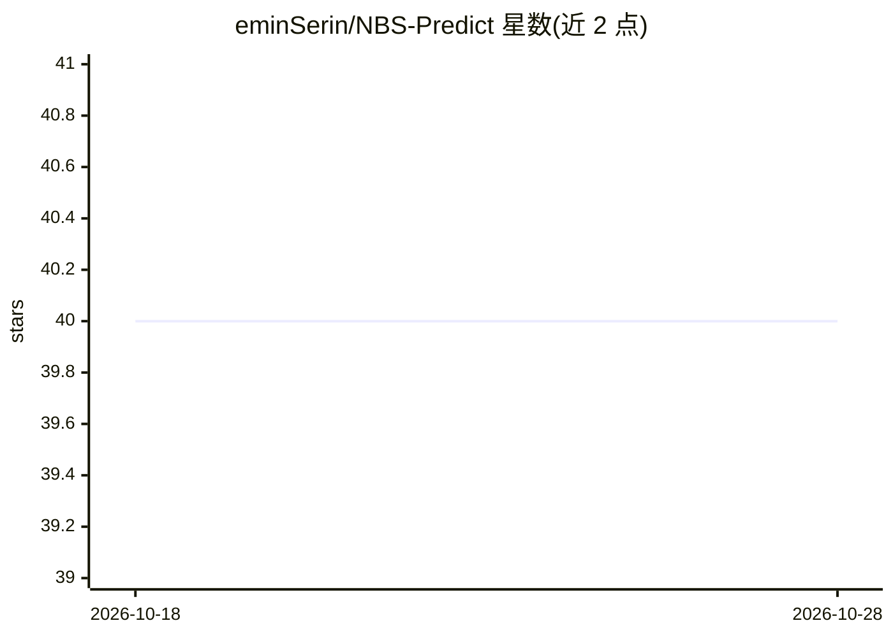

# eminSerin/NBS-Predict

⭐ 40 · MATLAB · GPL-3.0 · 推送 2026-05-26 · [GitHub](https://github.com/eminSerin/NBS-Predict) · 个人维护

**MATLAB 工具箱：结合机器学习与图论识别神经影像生物标志物**

NBS-Predict 是 Network-based Statistic 的预测式扩展，以交叉验证结构（可嵌套做超参数优化）结合机器学习与图论，从脑连接组数据中识别具有泛化能力的神经影像生物标志物并输出预测。读取连接矩阵、设计矩阵与脑分区文件，GUI 方式运行，另提供命令行接口支持终端与 SLURM 集群无头运行；结果查看器可展示邻接矩阵、环形网络图、3D 脑表面网络与混淆矩阵。要求 MATLAB 2020b 及以上与 Statistics and Machine Learning Toolbox。

## 筛选速览

| 维度 | 判定 | 备注 |
|---|---|---|
| AI 角色 | `ai-native` | 本体是模型或模型工具 |
| 许可风险 | `viral` | GPL-3.0 |
| 部署形态 | `None` |  |
| 模型依赖 | — | README 未给出锁定关系 |
| 硬件要求 | — | 无带数字的原话,不猜 |
| 安装摩擦 | `low` | 无编译、无系统依赖或容器化 |
| 成熟度 | — | 结构信号不足 |

## 能力要点

- 交叉验证结构（可嵌套超参数优化）下的边选择与机器学习预测
- GUI 与 headless CLI 两种运行方式，支持 SLURM 集群作业
- 结果查看器展示邻接矩阵、环形图、3D 脑表面网络与混淆矩阵
- 提供合成网络测试与仿真函数验证预测性能

## 适用场景

- 从脑连接组数据中识别可用于分类/回归预测的生物标志物边
- 在高性能集群上批量运行连接组预测分析
- 以合成数据验证工具箱运行与算法性能

## 场景标签

`数据分析` · 领域:效率与自动化

## 证据(README 行号)

> L3: NBS-Predict is a prediction-based extension of the Network-based Statistic (Zalesky et. al., 2010). NBS-Predict aims
> L6: NBS-Predict operates in a cross-validation structure (nested if hyperparameter optimization is desired). The general

## 星数曲线

2026-10-18 40 → 2026-10-28 40（+0）

---
*卡片 v1 · prompt 1.4 · 生成 2026-10-25 · 置信度 high · 依据 README sha `164ebf1e2dd7` · [字段定义](../../DATASET.md)*
