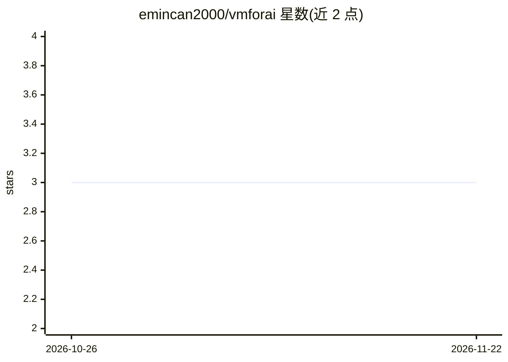

# emincan2000/vmforai

⭐ 3 · Shell · MIT · 推送 2026-10-28 · [GitHub](https://github.com/emincan2000/vmforai) · [官网](vmforai.is-cool.dev) · 个人维护

**把 AI 编码代理放进虚拟机沙箱运行，一条命令可撤销**

单个 Bash 脚本工具：用一条命令在 libvirt 等虚拟机内启动 Claude Code、Codex、Gemini CLI、OpenCode 或 aider，经 SSH 在 tmux 中打开代理会话。每次启动先拍快照，vmforai undo 可整体回滚代理在 VM 内的全部改动；仓库以副本进入 VM，成果以 git 分支返回，宿主机不留 SSH key 或 token。支持后台任务、多副本并行试做、issue 转 PR、受限网络白名单、手机端经 Tailscale 操作，以及 Windows VM（Windows 宿主经 WSL）。依赖宿主 libvirt/QEMU 与 OpenSSH。

## 筛选速览

| 维度 | 判定 | 备注 |
|---|---|---|
| AI 角色 | `ai-ecosystem` | LLM/agent 周边工具 |
| 许可风险 | `permissive` | MIT |
| 部署形态 | `desktop` | 安装包/桌面程序 |
| 模型依赖 | locked-api |  |
| 硬件要求 | — | 无带数字的原话,不猜 |
| 安装摩擦 | `medium` | 含编译或系统依赖之一 |
| 成熟度 | — | 结构信号不足 |

## 能力要点

- 一条命令在 VM 内启动代理，快照快照 undo 整体回滚
- 五个代理（Claude Code/Codex/Gemini CLI/OpenCode/aider）首次使用时安装
- issue 转 PR、任务多副本并行试做、受限网络白名单
- 手机扫码经 Tailscale 从浏览器操作 VM 与代理

## 适用场景

- 让编码代理放手执行 rm/sudo 等高风险操作而不动宿主机
- 从 GitHub issue 在隔离 VM 中自动产出 PR
- 在手机上给 VM 里的代理派任务并跟进结果
- 安全试用陌生 GitHub 仓库的构建与测试

## 场景标签

`编码 Agent` · 领域:编码与开发

## 证据(README 行号)

> L23: **vmforai** runs Claude Code, Codex, Gemini CLI, OpenCode or aider **inside a
> L85: A single Bash script with no dependencies beyond OpenSSH (and virsh for
> L100: vmforai is for when the agent should have a whole machine to itself, and

## 星数曲线

2026-10-26 3 → 2026-11-22 3（+0）

---
*卡片 v1 · prompt 1.4 · 生成 2026-11-22 · 置信度 mid · 依据 README sha `5e85635ee09d` · [字段定义](../../DATASET.md)*
