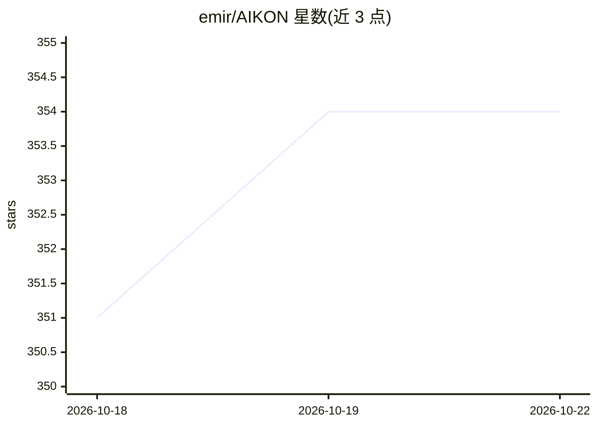

# emir/AIKON

⭐ 353 · Java · MIT · 推送 2026-10-04 · [GitHub](https://github.com/emir/AIKON) · [官网](https://aikonchat.com/) · 个人维护

**让 2007 年诺基亚功能机用上 Claude/ChatGPT 等 AI 聊天**

面向 Nokia S40/Symbian S60 功能机的 AI 聊天客户端（Java ME MIDlet，约 220 KB JAR），加一个 Go 编写的自托管服务器。服务器以 TLS 1.0 对接老手机、以现代 HTTPS 对接 Claude（官方 SDK）、OpenAI、Gemini 与 Grok，用户按聊天选择模型。功能含网页搜索（新闻/天气/汇率）、长回复分页、语音转文字、照片提问、日历待办写入、八种语言界面。需自备 VPS、API key 与私有 CA 证书；服务器以 Docker 镜像或单一二进制分发。

## 筛选速览

| 维度 | 判定 | 备注 |
|---|---|---|
| AI 角色 | `ai-native` | 本体是模型或模型工具 |
| 许可风险 | `permissive` | MIT |
| 部署形态 | `None` |  |
| 模型依赖 | locked-api |  |
| 硬件要求 | — | 无带数字的原话,不猜 |
| 安装摩擦 | `medium` | 含编译或系统依赖之一 |
| 成熟度 | — | 结构信号不足 |

## 能力要点

- 按聊天选择 Claude/OpenAI/Gemini/Grok 模型，回复标注所用模型
- 自建 Go 服务器解决老手机 TLS 1.0 无法直连现代 HTTPS 的问题
- 网页搜索、语音转文字、照片提问、写入手机日历/待办
- 八种语言界面与键盘优先操作（含 QWERTY 机型）

## 适用场景

- 在旧诺基亚功能机上使用多模型 AI 聊天
- 功能机用户通过 AI 获取新闻、天气、汇率等实时信息
- 极客为自己的收藏老手机搭建自托管 AI 通道

## 场景标签

`聊天机器人` · 领域:对话与助手

## 证据(README 行号)

> L12: **Today's AI on a 2007 Nokia.** AIKON is an AI chat client for
> L14: the small Go server it talks to. Pick a model per chat (Claude, OpenAI, Gemini or Grok),

## 星数曲线

2026-10-18 351 → 2026-10-22 354（+3）

---
*卡片 v1 · prompt 1.4 · 生成 2026-10-21 · 置信度 high · 依据 README sha `a683441aeaa9` · [字段定义](../../DATASET.md)*
