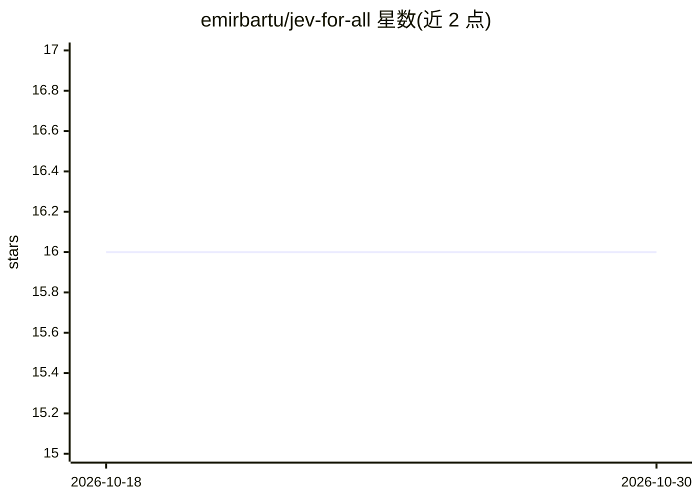

# emirbartu/jev-for-all

⭐ 16 · TypeScript · MIT · 推送 2026-10-08 · [GitHub](https://github.com/emirbartu/jev-for-all) · 个人维护

**把 Jev 决策模型接入编码 agent 的插件：选技能、选模型、选工具**

将 TypeSafe 的 System One（Jev）决策模型通过统一契约接入 OpenCode、Claude Code、Hermes 与 pi 等编码 agent 的插件集。Jev 运行于 OpenRouter 的 alpha Decisions API（非 LLM），输入状态、返回带置信度的类型化答案，据此决定加载哪个技能、选择哪一档模型与思考力度、裁剪工具集及 browser_task 内的每步操作。提供 bunx/npx 安装、doctor 自检与分层路由（light/standard/heavy）。作者声明项目完全实验性，不适用于生产；数据来自 12 个小型单文件任务，且提示层默认关闭、决策需将提示词与近期对话发送至远端 API。

## 筛选速览

| 维度 | 判定 | 备注 |
|---|---|---|
| AI 角色 | `ai-ecosystem` | LLM/agent 周边工具 |
| 许可风险 | `permissive` | MIT |
| 部署形态 | `library` | 以包/库形式分发 |
| 模型依赖 | locked-api |  |
| 硬件要求 | — | 无带数字的原话,不猜 |
| 安装摩擦 | `medium` | 含编译或系统依赖之一 |
| 成熟度 | `idea` | |

## 能力要点

- 统一决策契约接入 OpenCode、Claude Code、Hermes、pi 四种 harness
- 每条决策约 0.5 秒、约 $0.0001，失败或不确定时插件不动作
- 三档模型路由（light/standard/heavy）与 lean 会话（关闭技能与 MCP）
- jev-for-all doctor 自检各组件并给出修复指引

## 适用场景

- 让编码 agent 自动选择该加载的技能与该用的工具子集
- 在廉价订阅间分配任务：简单工作交给 haiku 等 light 档模型
- browser_task 中逐步决定点击目标与输入值

## 场景标签

`编码 Agent` · 领域:编码与开发

## 证据(README 行号)

> L4: typed answer and a confidence score. This repo connects Jev to coding agents so they can ask it
> L65: Jev runs on OpenRouter's alpha Decisions API. It is not an LLM. You pass it state, it returns
> L66: typed answers with a calibrated confidence for each. The repo connects it to OpenCode, Claude

## 星数曲线

2026-10-18 16 → 2026-10-30 16（+0）

---
*卡片 v1 · prompt 1.4 · 生成 2026-10-30 · 置信度 mid · 依据 README sha `a07179b288d6` · [字段定义](../../DATASET.md)*
