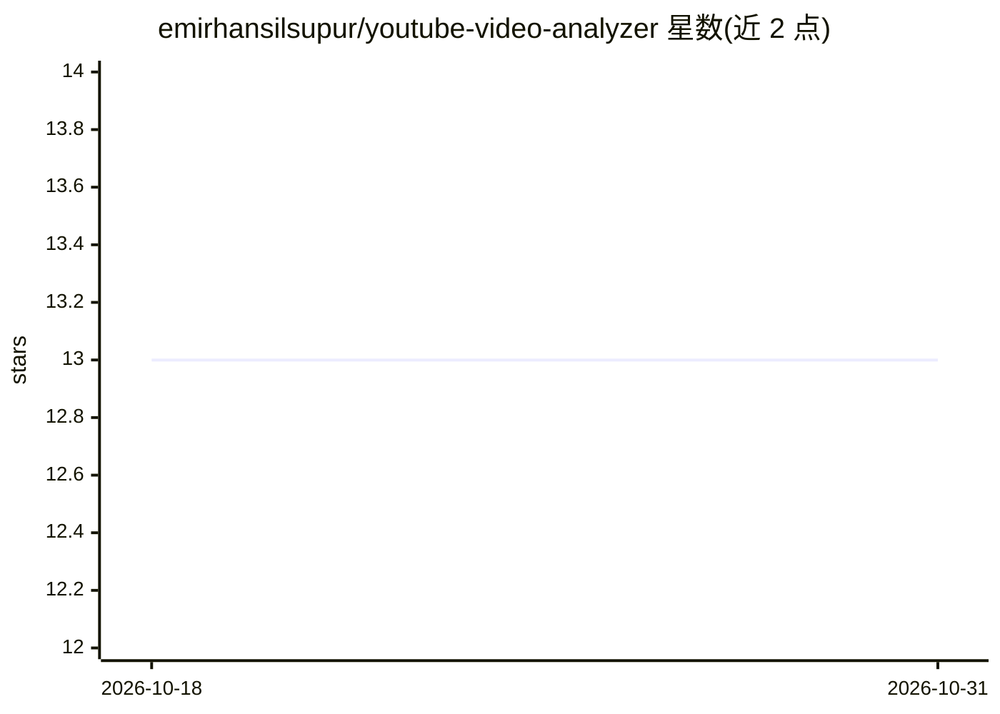

# emirhansilsupur/youtube-video-analyzer

⭐ 13 · Python · MIT · 推送 2026-10-05 · [GitHub](https://github.com/emirhansilsupur/youtube-video-analyzer) · 个人维护

**给内容创作者的分析工具：多 agent 分析 YouTube 视频并生成 PDF 报告**

基于 CrewAI 多代理与 Streamlit 的 YouTube 视频分析应用：抓取视频元数据、分析评论与观众情绪、生成表现与互动报告并导出 PDF。支持 Llama 3.1 70B、Llama 3 70B、Mixtral 8x7B 三种 LLM（经 Groq API），需配置 Groq 与 YouTube Data API key。提供 Docker 镜像或 Poetry 手动安装并以 Streamlit 运行。功能为'基础分析'。

## 筛选速览

| 维度 | 判定 | 备注 |
|---|---|---|
| AI 角色 | `ai-native` | 本体是模型或模型工具 |
| 许可风险 | `permissive` | MIT |
| 部署形态 | `self-host` | docker 或自建部署 |
| 模型依赖 | locked-api |  |
| 硬件要求 | — | 无带数字的原话,不猜 |
| 安装摩擦 | `low` | 无编译、无系统依赖或容器化 |
| 成熟度 | — | 结构信号不足 |

## 能力要点

- 多 agent 流程：抓取元数据→评论情绪分析→生成报告→PDF 导出
- 支持 Llama 3.1 70B / Llama 3 70B / Mixtral 8x7B 三种 LLM
- Streamlit Web 界面，输入视频 URL 即可分析

## 适用场景

- 分析自己视频的观众评论与情绪
- 生成视频表现与互动报告并导出 PDF
- 对比多个 LLM 在视频分析任务上的表现

## 场景标签

`多智能体` `数据分析` · 领域:Agent 开发

## 证据(README 行号)

> L3: YouTube Video Inspector is a multi-agent-based project that provides basic analysis of YouTube videos. It fetches vi
> L25: - **Supports multiple LLMs**:

## 星数曲线

2026-10-18 13 → 2026-10-31 13（+0）

---
*卡片 v1 · prompt 1.4 · 生成 2026-10-31 · 置信度 mid · 依据 README sha `0e7cbe0afaf4` · [字段定义](../../DATASET.md)*
