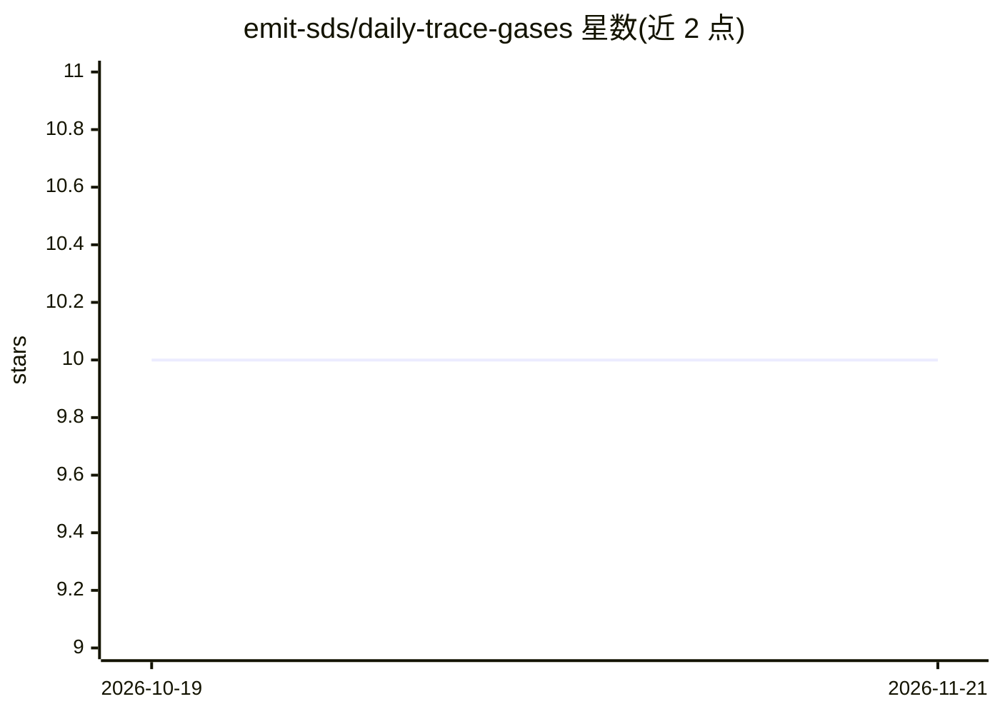

# emit-sds/daily-trace-gases

⭐ 10 · Jupyter Notebook · Apache-2.0 · 推送 2026-10-10 · [GitHub](https://github.com/emit-sds/daily-trace-gases) · [官网](https://www.nature.com/articles/s41598-026-70499-1) · 组织维护

**检测甲烷等四种痕量气体羽流的科研代码库**

论文 Fully Automatic Trace Gas Plume Detection 的官方代码库，复现 EMIT 影像中 CH4、NH3、NO2、CO 点源事件的自动检测。采用三步流水线：对每种气体计算 matched filter（WMF/CMF 变体）产品，用预训练机器学习模型勾勒羽流轮廓（含从甲烷到其他气体的零样本泛化示例），再用光谱拟合评分对预测打分。需注册 NASA Earthdata 免费账号下载 L1B 辐射数据；提供 Colab 演示笔记本、Hugging Face 模型权重（合计约 250MB）与数据集；甲烷模型与其余气体所用模型和滤波变体不同。

## 筛选速览

| 维度 | 判定 | 备注 |
|---|---|---|
| AI 角色 | `ai-native` | 本体是模型或模型工具 |
| 许可风险 | `permissive` | Apache-2.0 |
| 部署形态 | `None` |  |
| 模型依赖 | — | README 未给出锁定关系 |
| 硬件要求 | — | 无带数字的原话,不猜 |
| 安装摩擦 | `low` | 无编译、无系统依赖或容器化 |
| 成熟度 | — | 结构信号不足 |

## 能力要点

- 三步流水线：MF 产品→ML 羽流勾勒→光谱拟合评分
- 支持 ch4/nh3/no2/co 四种气体点源检测
- 展示甲烷预训练模型到其他气体的零样本泛化
- 提供 Colab 演示与 Hugging Face 模型权重

## 适用场景

- 复现论文中的痕量气体羽流检测方法
- 对指定 EMIT 场景与目标气体运行自动检测
- 在论文发表数据集中选取场景做零样本实验

## 场景标签

`科研工具` `目标检测` · 领域:学习与行业

## 证据(README 行号)

> L3: This is the official code base for the paper "**Fully Automatic Trace Gas Plume Detection**". It allows full reconst
> L50: We currently support these options for the selection of target trace gas: `ch4, nh3, no2, co`

## 星数曲线

2026-10-19 10 → 2026-11-21 10（+0）

---
*卡片 v1 · prompt 1.4 · 生成 2026-11-19 · 置信度 high · 依据 README sha `fc5a533b7869` · [字段定义](../../DATASET.md)*
