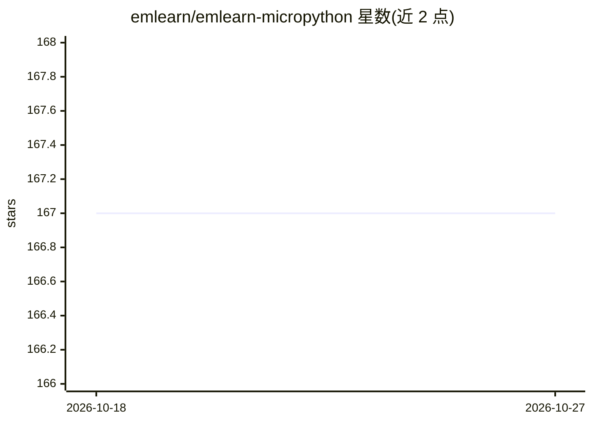

# emlearn/emlearn-micropython

⭐ 167 · C · MIT · 推送 2026-07-30 · [GitHub](https://github.com/emlearn/emlearn-micropython) · [官网](https://emlearn-micropython.readthedocs.io/en/latest/) · 个人维护

**MicroPython 上的 TinyML 与 DSP 模块：微控制器运行 ML 模型**

为 MicroPython 提供 Machine Learning 与数字信号处理模块，使应用开发者无需编写 C 代码即可在微控制器上运行机器学习模型。底层基于 C99 库 emlearn，以运行时可安装的原生模块（.mpy）形式分发，也可作为外部 C 模块编入自定义 MicroPython 构建。支持随机森林/决策树/KNN/CNN 分类、线性回归、FFT、IIR 滤波、K-means 等；推理时间可低至 100 微秒量级，RAM 与 FLASH 占用各小于 2 kB。作者自称状态为“Minimally useful”，主要在 x64（Unix port）与 xtensawin（ESP32 系列）上测试。

## 筛选速览

| 维度 | 判定 | 备注 |
|---|---|---|
| AI 角色 | `ai-native` | 本体是模型或模型工具 |
| 许可风险 | `permissive` | MIT |
| 部署形态 | `None` |  |
| 模型依赖 | — | README 未给出锁定关系 |
| 硬件要求 | — | 无带数字的原话,不猜 |
| 安装摩擦 | `low` | 无编译、无系统依赖或容器化 |
| 成熟度 | `idea` | |

## 能力要点

- 随机森林/决策树/KNN/CNN 分类与线性回归，含设备端学习（KNN/树）
- FFT、IIR 滤波、K-means、PLSR 等 DSP 与特征预处理模块
- 以 .mpy 原生模块运行时安装，无需重刷固件；模型可从磁盘/闪存加载
- 推理低至 100 微秒量级，RAM/FLASH 占用各 <2 kB

## 适用场景

- 在 ESP32 等微控制器上部署低功耗分类任务
- 加速度计人体活动识别、声音级别测量等嵌入式示例场景
- MicroPython 应用中加入传感器数据的 ML 推理而不写 C 代码

## 场景标签

`推理引擎` · 领域:训练与推理

## 证据(README 行号)

> L6: Provides convenient and efficient MicroPython modules, and enables MicroPython application developers
> L10: particularly well suited for low-compexity and low-power classification tasks.

## 星数曲线

2026-10-18 167 → 2026-10-27 167（+0）

---
*卡片 v1 · prompt 1.4 · 生成 2026-10-22 · 置信度 high · 依据 README sha `355404b010a0` · [字段定义](../../DATASET.md)*
