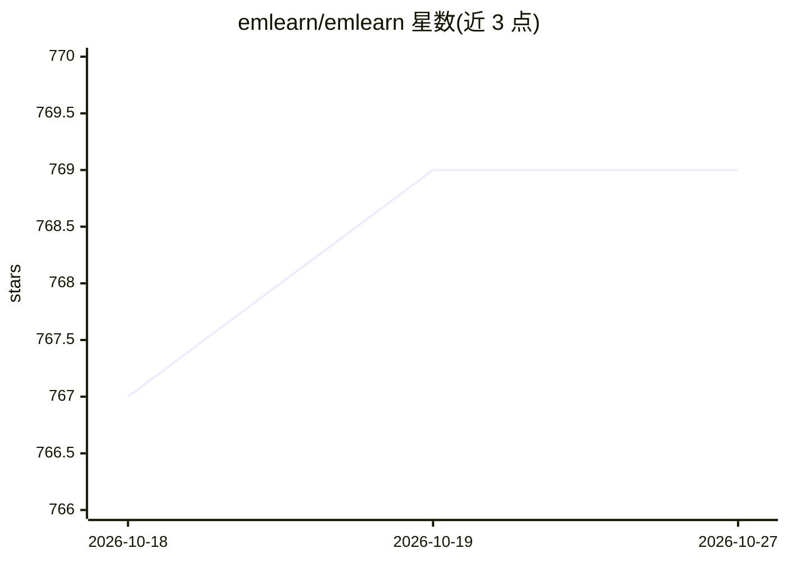

# emlearn/emlearn

⭐ 769 · Python · MIT · 推送 2026-07-17 · [GitHub](https://github.com/emlearn/emlearn) · 组织维护

**将 Python 训练的机器学习模型转为 C99 代码，供微控制器推理**

面向微控制器与嵌入式设备的机器学习推理引擎：在 Python 中用 scikit-learn 或 Keras 训练模型，经 emlearn.convert 转换为可移植的 C99 代码（单头文件），复制到嵌入式项目中即可运行推理。支持树模型集成（随机森林/决策树）、MLP 神经网络、朴素贝叶斯、高斯混合等，覆盖分类、回归与异常检测。生成的代码无动态分配，代码体积可低至 2kB FLASH、50 字节 RAM，部分模型支持定点整数运算且无需 libc。附带 IIR 滤波、FFT、CSV 读写等数据处理工具及模型体积/计算成本估算工具。以 Arduino 库、Zephyr 模块、MicroPython 绑定形式打包，MIT 许可。

## 筛选速览

| 维度 | 判定 | 备注 |
|---|---|---|
| AI 角色 | `ai-native` | 本体是模型或模型工具 |
| 许可风险 | `permissive` | MIT |
| 部署形态 | `library` | 以包/库形式分发 |
| 模型依赖 | — | README 未给出锁定关系 |
| 硬件要求 | — | 无带数字的原话,不猜 |
| 安装摩擦 | `low` | 无编译、无系统依赖或容器化 |
| 成熟度 | — | 结构信号不足 |

## 能力要点

- scikit-learn/Keras 模型转换为可移植 C99 单头文件
- 无动态分配，低至 2kB FLASH / 50 字节 RAM
- 支持随机森林、MLP、朴素贝叶斯、高斯混合等模型的分类/回归/异常检测
- 附 IIR 滤波、FFT、CSV 流式读写等特征处理与模型体积估算工具

## 适用场景

- 把传感器数据的分类模型部署到 ESP32、AVR 等 MCU 上
- 在无操作系统的裸机或 RTOS 环境运行机器学习推理
- 在部署前估算模型的 FLASH/RAM 与计算成本

## 场景标签

`推理引擎` · 领域:训练与推理

## 证据(README 行号)

> L6: Machine learning for microcontroller and embedded systems.
> L7: Train in Python, then do inference on any device with a C99 compiler.

## 星数曲线

2026-10-18 767 → 2026-10-27 769（+2）

---
*卡片 v1 · prompt 1.4 · 生成 2026-10-21 · 置信度 high · 依据 README sha `3034cba99a85` · [字段定义](../../DATASET.md)*
