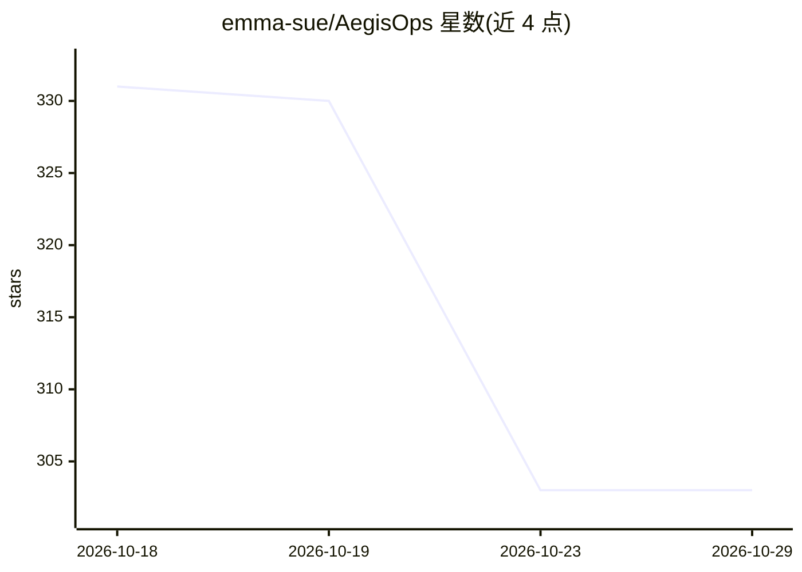

# emma-sue/AegisOps

⭐ 303 · Python · 推送 2026-09-10 · [GitHub](https://github.com/emma-sue/AegisOps) · 个人维护 · 中文 README

**企业信息系统运维 Agent 平台：自动巡检、AI 故障排查与证据工单**

面向企业内部信息系统的运维工作台，把巡检、告警、Agent 诊断、证据工单、人工审批与结果复核整合在同一流程中。巡检规则发现异常，LangGraph 管理流程、Deep Agents 承担调查，通过只读工具与 MCP 适配读取指标、日志、调用链等证据；Agent 仅在授权范围内取证，不能直接调用宿主 shell。技术栈含 PostgreSQL/pgvector、Redis Streams、Spring Boot、FastAPI、Vue 3。支持无密钥演示模式；Compose 容器构建与运行尚未实测，当前仅验证 macOS 原生运行。

## 筛选速览

| 维度 | 判定 | 备注 |
|---|---|---|
| AI 角色 | `ai-native` | 本体是模型或模型工具 |
| 许可风险 | `none` | — |
| 部署形态 | `self-host` | docker 或自建部署 |
| 模型依赖 | — | README 未给出锁定关系 |
| 硬件要求 | — | 无带数字的原话,不猜 |
| 安装摩擦 | `low` | 无编译、无系统依赖或容器化 |
| 成熟度 | — | 结构信号不足 |

## 能力要点

- 8 项巡检规则与 Agent 故障排查（LangGraph + Deep Agents + MCP）
- 证据与工单绑定，保存证据原文与哈希，支持审批、租约与中断续跑
- 限制取证轮数、模型请求与 Token，保存调用用量与失败记录
- 默认 AI_MODE=fixture 无密钥演示模式

## 适用场景

- 值班人员自动巡检发现异常并收集证据排查
- 生成带证据的工单草稿并交接处理任务
- 演练处置经授权审批后执行并复查业务结果

## 场景标签

`工作流自动化` · 领域:效率与自动化

## 证据(README 行号)

> L9: 面向企业内部信息系统的运维工作台。把巡检、告警、Agent 诊断、工单、审批和结果复核放在同一个流程中，帮助值班人员收集证据、确认排查方向、交接处理任务。
> L41: |Agent 故障排查|LangGraph 管理流程，Deep Agents 承担调查；按需加载 Skills，通过只读工具与 MCP 适配读取任务证据|
> L51: |Agent|**LangGraph · Deep Agents · Skills · MCP**：诊断编排、上下文管理、受限工具调用|

## 星数曲线

2026-10-18 331 → 2026-10-29 303（-28）

---
*卡片 v1 · prompt 1.4 · 生成 2026-10-21 · 置信度 high · 依据 README sha `5fe2f235a0d7` · [字段定义](../../DATASET.md)*
