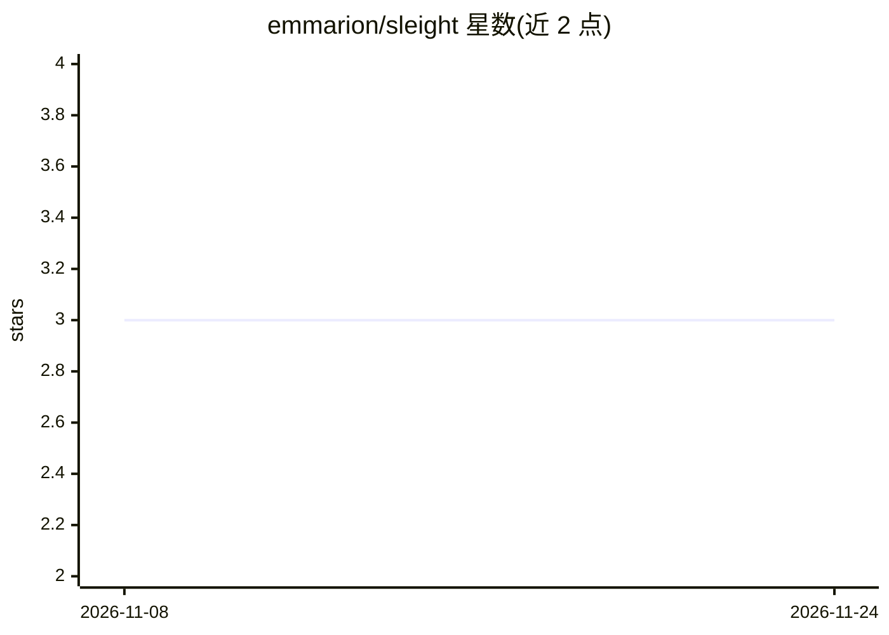

# emmarion/sleight

⭐ 3 · Scheme · Apache-2.0 · 推送 2026-11-20 · [GitHub](https://github.com/emmarion/sleight) · 个人维护

**带依赖类型与终止检查的 s-expression 语言，为 LLM 写作而设计**

Sleight 是一种 s-expression 语法的静态类型编程语言：受限依赖类型、每个绑定器带 erased/many/unique 乘性标注、无可逃逸的终止检查、编译期检查性能声明。仓库提供三个实现：OCaml 参考解释器/编译器、自举到 OCaml 的 slc 编译器、Lean 4 形式化模型（含机器检查定理），共享千余条测试。设计目标之一是支持 LLM 在此语言中写代码，agent/ 目录在多个会话上运行 LLM agent 编程任务；仓库声明由一人设计、LLM agent 撰写实现与文档。

## 筛选速览

| 维度 | 判定 | 备注 |
|---|---|---|
| AI 角色 | `ai-enhanced` | 去掉 AI 部分产品仍成立 |
| 许可风险 | `permissive` | Apache-2.0 |
| 部署形态 | `desktop` | 安装包/桌面程序 |
| 模型依赖 | — | README 未给出锁定关系 |
| 硬件要求 | — | 无带数字的原话,不猜 |
| 安装摩擦 | `low` | 无编译、无系统依赖或容器化 |
| 成熟度 | — | 结构信号不足 |

## 能力要点

- OCaml 参考实现、slc 自举编译器与 Lean 4 机器检查模型三套实现共享测试套件
- 每个绑定器声明乘性（erased/many/unique），unique 绑定支持原地更新
- agent/ 目录运行 LLM agent 完成 Sleight 编程任务（如 heapsort）
- 附 certified 程序与证明：四色定理、BB(5)=47,176,870、STLC 强规范化等

## 适用场景

- 研究依赖类型、终止检查与自举的语言设计
- 运行 LLM agent 在带证明的语言上完成编程任务并计时对比
- 用 Lean 模型做形式化验证实验

## 场景标签

`编码 Agent` `代码生成` · 领域:编码与开发

## 证据(README 行号)

> L14: compiling cleanly with static types; to support LLMs writing code in
> L94: `agent/` runs LLM agents on Sleight programming tasks over many
> L165: One person designs the language; LLM agents, at the owner's request,

## 星数曲线

2026-11-08 3 → 2026-11-24 3（+0）

---
*卡片 v1 · prompt 1.4 · 生成 2026-11-22 · 置信度 high · 依据 README sha `28ecf2c076f8` · [字段定义](../../DATASET.md)*
