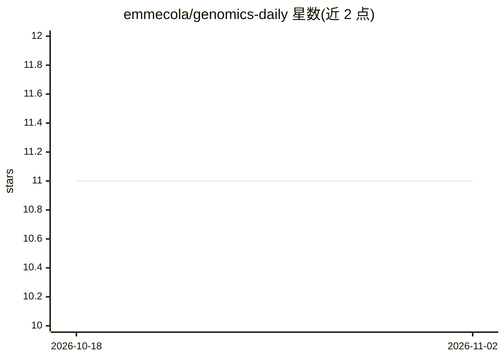

# emmecola/genomics-daily

⭐ 11 · Python · MIT · 推送 2026-04-16 · [GitHub](https://github.com/emmecola/genomics-daily) · [官网](https://codeberg.org/emmecola/genomics-daily) · 个人维护

**自动检索并摘要最新基因组学文献的 Python 脚本**

Genomics Daily 是一个 Python 脚本工具：按 keywords.txt 中的关键词检索指定期刊列表的基因组学新论文，默认取最近 1 天（可调 --days-back），调用 Anthropic Claude API 对最相关论文生成摘要，并可通过 bot 脚本发布 summary.md。需用户自备 Anthropic API key，通过环境变量配置；支持 simple/advanced 两种摘要模式，关键词与期刊列表均可自定义编辑。以源码仓库形式提供，运行需安装 anthropic、pandas、requests 依赖。

## 筛选速览

| 维度 | 判定 | 备注 |
|---|---|---|
| AI 角色 | `ai-native` | 本体是模型或模型工具 |
| 许可风险 | `permissive` | MIT |
| 部署形态 | `library` | 以包/库形式分发 |
| 模型依赖 | locked-api |  |
| 硬件要求 | — | 无带数字的原话,不猜 |
| 安装摩擦 | `low` | 无编译、无系统依赖或容器化 |
| 成熟度 | — | 结构信号不足 |

## 能力要点

- 按关键词与期刊白名单过滤文献检索
- 调用 Anthropic Claude 生成论文摘要（simple/advanced 模式）
- 可配置回溯天数，默认检索最近 1 天
- 附带 bot 脚本用于发布 summary.md

## 适用场景

- 每日追踪基因组学领域最新发表论文
- 按自定义关键词和期刊列表获取定向文献摘要
- 生成研究动态简报用于分享

## 场景标签

`科研工具` · 领域:学习与行业

## 证据(README 行号)

> L9: Genomics Daily is an automated tool that retrieves and summarizes the latest genomics publications from major scient
> L13: - Utilizes Claude AI by Anthropic to generate summaries of the most relevant papers

## 星数曲线

2026-10-18 11 → 2026-11-02 11（+0）

---
*卡片 v1 · prompt 1.4 · 生成 2026-11-02 · 置信度 high · 依据 README sha `a01d9040a47e` · [字段定义](../../DATASET.md)*
