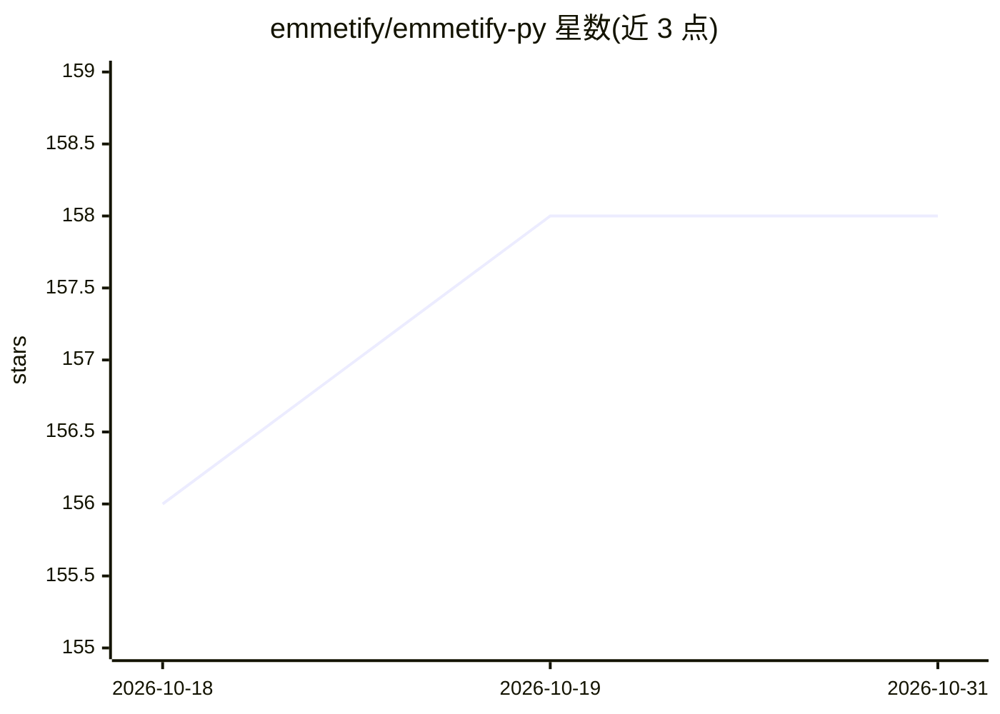

# emmetify/emmetify-py

⭐ 158 · Python · Apache-2.0 · 推送 2026-07-10 · [GitHub](https://github.com/emmetify/emmetify-py) · [官网](https://emmetify.com) · 个人维护

**将 HTML 转为 Emmet 记法以缩减 LLM token 的 Python 库**

面向使用 LLM 处理网页的 agent 开发者的预处理库：读取完整 HTML，输出等价结构的 Emmet 紧凑记法（如 div.container>header.header>...），官方示例显示单例 59→22 token、约 63% 缩减，配置项（去冗余标签、简化属性、优化类名、缩短 URL）可达更高压缩率。保留 DOM 结构以配合 Selenium/Playwright 类工具做元素定位，避免 Markdown 丢结构的问题。以 pip 安装的 Python 包提供，当前支持 HTML，XML/JSON 标注为开发中。

## 筛选速览

| 维度 | 判定 | 备注 |
|---|---|---|
| AI 角色 | `ai-ecosystem` | LLM/agent 周边工具 |
| 许可风险 | `permissive` | Apache-2.0 |
| 部署形态 | `library` | 以包/库形式分发 |
| 模型依赖 | — | README 未给出锁定关系 |
| 硬件要求 | — | 无带数字的原话,不猜 |
| 安装摩擦 | `low` | 无编译、无系统依赖或容器化 |
| 成熟度 | `idea` | |

## 能力要点

- HTML→Emmet 转换，示例中 token 缩减约 63%
- 高级配置：跳过非必要标签、优先保留关键属性、优化类名与 URL
- 保留 DOM 结构以生成 XPath/CSS 选择器
- 支持 HTML，XML/JSON 为规划中格式

## 适用场景

- LLM 网页自动化 agent 中压缩待分析的 HTML 上下文
- 降低送入 LLM 的 HTML token 成本
- 在保留元素定位能力的前提下做网页结构预处理

## 场景标签

 · 领域:LLM 基础设施/网页处理

## 证据(README 行号)

> L10: Cut your LLM processing costs by up to 90% by transforming verbose HTML into efficient Emmet notation, without losi
> L14: - 💰 **Drastically Reduce Costs** - Process HTML with your LLM agents at a fraction of the cost by using our efficie

## 星数曲线

2026-10-18 156 → 2026-10-31 158（+2）

---
*卡片 v1 · prompt 1.4 · 生成 2026-10-23 · 置信度 high · 依据 README sha `04ff94f99b90` · [字段定义](../../DATASET.md)*
