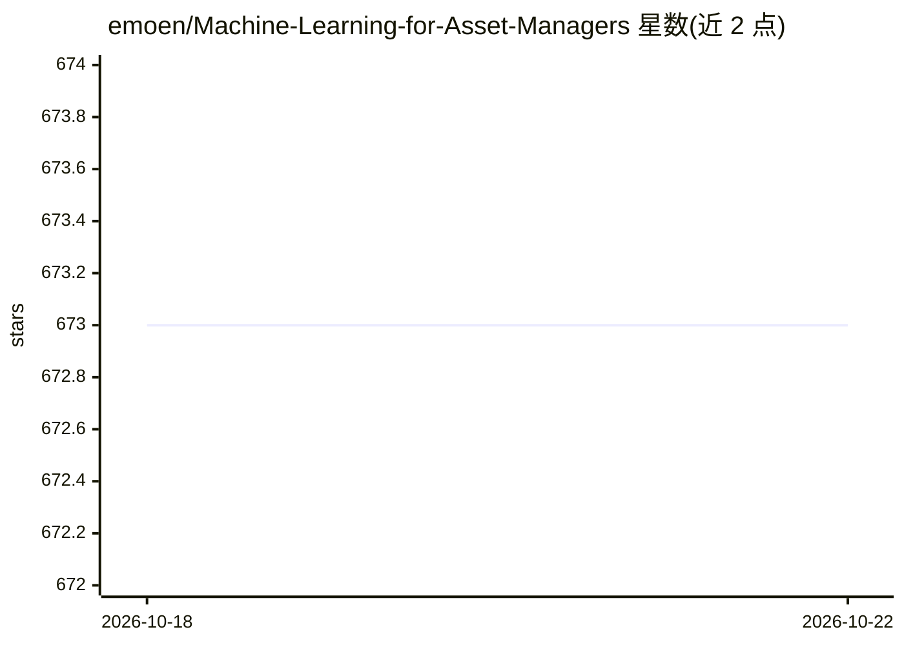

# emoen/Machine-Learning-for-Asset-Managers

⭐ 674 · Python · Apache-2.0 · 推送 2026-02-11 · [GitHub](https://github.com/emoen/Machine-Learning-for-Asset-Managers) · 个人维护

**《Machine Learning for Asset Managers》一书的代码片段与练习实现**

Python 库，逐章实现 Marcos López de Prado《Machine Learning for Asset Managers》中的代码片段与练习：相关矩阵去噪与去调（Marcenko-Pastur）、距离度量（含熵与信息变化）、ONC 最优聚类、金融标签（Triple-Barrier、趋势扫描）、特征重要性（MDI/MDA）与组合构建（HRP、NCO）。作者声明项目用于个人学习，实用应用建议参考 Hudson & Thames 的 mlfinlab，并指出书中 ONC 算法存在的问题。通过 pip 从 GitHub 安装。

## 筛选速览

| 维度 | 判定 | 备注 |
|---|---|---|
| AI 角色 | `ai-native` | 本体是模型或模型工具 |
| 许可风险 | `permissive` | Apache-2.0 |
| 部署形态 | `library` | 以包/库形式分发 |
| 模型依赖 | — | README 未给出锁定关系 |
| 硬件要求 | — | 无带数字的原话,不猜 |
| 安装摩擦 | `low` | 无编译、无系统依赖或容器化 |
| 成熟度 | — | 结构信号不足 |

## 能力要点

- 覆盖第 2-7 章：去噪/去调、距离度量、ONC 聚类、金融标签、特征重要性、组合构建
- 实现含交叉验证选带宽的 KDE（练习 2.7）
- 指出书中 ONC 算法 bug 及子空间嵌入问题，并给出讨论链接

## 适用场景

- 学习《ML for Asset Managers》时对照运行书中代码
- 复现相关矩阵去噪、ONC 聚类、HRP/NCO 组合构建等算法
- 量化研究中的特征重要性与金融标签实验

## 场景标签

`金融量化` `教程课程` · 领域:学习与行业

## 证据(README 行号)

> L14: Implementation of code snippets and exercises from Machine Learning for Asset Managers (Elements in Quantitative Fi
> L17: The project is for my own learning. If you want to use the consepts from the book - you should head over to Hudson 

## 星数曲线

2026-10-18 673 → 2026-10-22 673（+0）

---
*卡片 v1 · prompt 1.4 · 生成 2026-10-21 · 置信度 mid · 依据 README sha `1688b578d163` · [字段定义](../../DATASET.md)*
