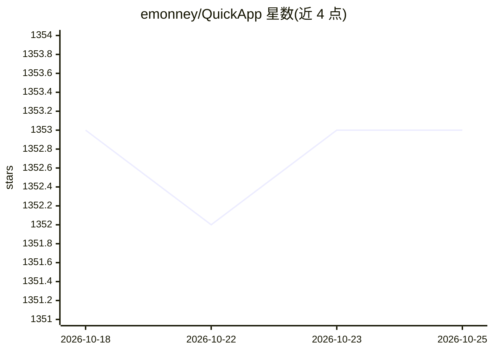

# emonney/QuickApp

⭐ 1,353 · TypeScript · MIT · 推送 2026-09-01 · [GitHub](https://github.com/emonney/QuickApp) · [官网](https://www.ebenmonney.com/quickapp) · 个人维护

**面向 AI 扩展的 Angular/ASP.NET Core 全栈参考架构模板**

Angular 21 + ASP.NET Core 10 的模板项目，预先实现认证授权（OpenIddict/OAuth2、JWT、刷新令牌）、用户与角色管理、权限策略、错误处理与集中验证等基础功能，并以 BaseEntity/BaseApiController/EndpointBase 等固定模式和 ai-rules/AI_RULES.md 规则文件，供 ChatGPT、Copilot、Claude、Cursor 等 AI 编码工具在其模式内扩展业务功能。提供 git 克隆与 Visual Studio 模板两种获取方式，需 dotnet restore、npm install、EF Core 迁移后运行；README 同时介绍其继任项目 NetForge。

## 筛选速览

| 维度 | 判定 | 备注 |
|---|---|---|
| AI 角色 | `ai-enhanced` | 去掉 AI 部分产品仍成立 |
| 许可风险 | `permissive` | MIT |
| 部署形态 | `library` | 以包/库形式分发 |
| 模型依赖 | — | README 未给出锁定关系 |
| 硬件要求 | — | 无带数字的原话,不猜 |
| 安装摩擦 | `medium` | 含编译或系统依赖之一 |
| 成熟度 | — | 结构信号不足 |

## 能力要点

- 内置 OpenIddict/OAuth2 认证、角色权限与自定义授权处理器的完整实现
- 提供 ai-rules/AI_RULES.md 开发规则文件与提示词指南供 AI 工具遵循
- Angular 21 + ASP.NET Core 10 全栈：Bootstrap 5、国际化、Swagger、审计追踪
- 可作为 Visual Studio Marketplace 模板安装

## 适用场景

- 以已实现认证与用户管理的全栈基座启动项目，再让 AI 编码工具扩展 CRUD 与业务功能
- 团队以固定模式约束 AI 生成代码的架构一致性
- 个人或企业项目获得可预测、带权限体系的前后端起点

## 场景标签

 · 领域:Web 开发/模板项目

## 证据(README 行号)

> L10: QuickApp is an opinionated Angular 21 + ASP.NET Core 10 starter that solves the *boring, fragile, and security-sens
> L38: **QuickApp provides a known-good foundation** where those hard problems are already solved. You start with QuickApp

## 星数曲线

2026-10-18 1,353 → 2026-10-25 1,353（+0）

---
*卡片 v1 · prompt 1.4 · 生成 2026-10-21 · 置信度 mid · 依据 README sha `4109757b58d3` · [字段定义](../../DATASET.md)*
