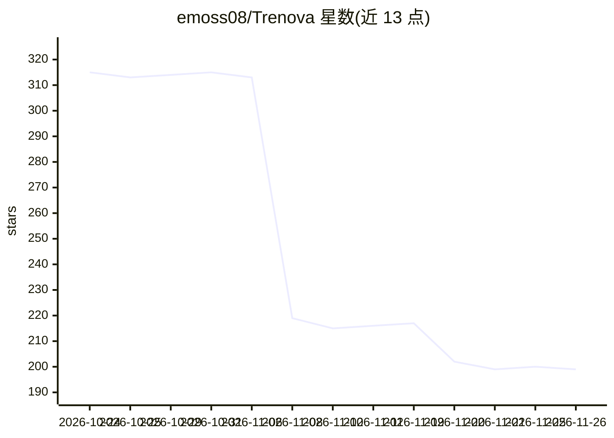

# emoss08/Trenova

⭐ 199 · Go · NOASSERTION · 推送 2026-11-25 · [GitHub](https://github.com/emoss08/Trenova) · [官网](https://trenova.app) · 组织维护

**面向美国中小公路货运承运商的 AI 驱动运输管理系统**

Trenova 是面向美国中小型整车公路承运商的运输管理系统（TMS），覆盖从接单到收款的完整流程：发货、调度、计费、会计与合规共用一条货运记录。核心功能对所有用户开放，附加模块按需开启。AI 部分（Trenova AI）包括调度台、分诊、瞭望塔以及处理舱位、滞期费、录入、计费与合规的 agent；文档智能将 BOL/POD/费率确认直接读入货运数据；支持 EDI 204/210/214/990/997、Samsara 远程信息处理与 PC*MILER。部署方式为官方托管、共享托管或 Docker Compose 自托管；当前处于 closed beta，自托管版本为预发布软件。

## 筛选速览

| 维度 | 判定 | 备注 |
|---|---|---|
| AI 角色 | `ai-enhanced` | 去掉 AI 部分产品仍成立 |
| 许可风险 | `none` | NOASSERTION |
| 部署形态 | `self-host` | docker 或自建部署 |
| 模型依赖 | — | README 未给出锁定关系 |
| 硬件要求 | — | 无带数字的原话,不猜 |
| 安装摩擦 | `low` | 无编译、无系统依赖或容器化 |
| 成熟度 | `idea` | |

## 能力要点

- Trenova AI：调度台、分诊、瞭望塔及覆盖/滞期/录入/计费/合规 agent，可运行在自选模型（托管或自有 GPU）
- 文档智能将 BOL、POD、费率确认读取为货运数据
- 自备 EDI 204/210/214/990/997、Samsara、PC*MILER、AS2 集成
- 自托管免费，Docker Compose 一键启动并自动 HTTPS

## 适用场景

- 管理货运订单全流程：调度、追踪、计费、账务与结算
- 通过 Freight Outlook 预判卡车运力缺口并让优化器建议派单
- 司机工时、薪资结算、资质与 FMCSA 合规一站式管理
- 与交易伙伴交换 EDI 单证并接入车队远程信息处理数据

## 场景标签

`工作流自动化` `文档解析` · 领域:效率与自动化

## 证据(README 行号)

> L2:  Trenova: Transportation Management System for Trucking Carriers
> L58: - **Trenova AI**: the Desk, triage, the watchtower, and agents that handle coverage, detention, intake, billing and
> L70: |**Shared Trenova**|A workspace on Trenova's shared servers: a small monthly base plus a charge per shipment. Comin

## 星数曲线

2026-10-24 315 → 2026-11-26 199（-116）

---
*卡片 v1 · prompt 1.4 · 生成 2026-11-26 · 置信度 high · 依据 README sha `8469fd644839` · [字段定义](../../DATASET.md)*
