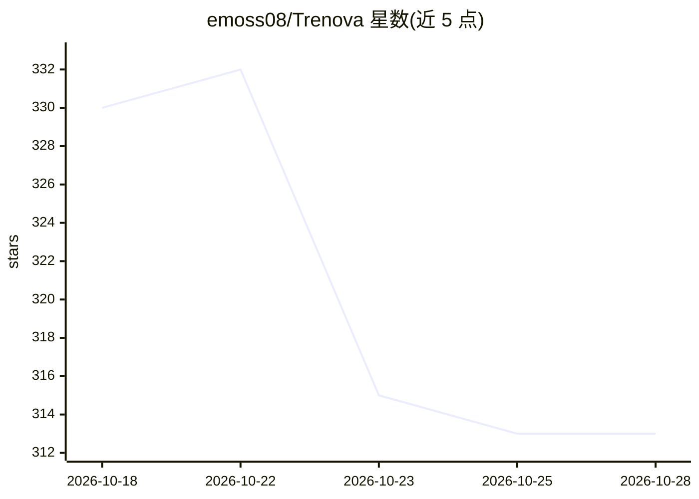

# emoss08/Trenova

⭐ 313 · Go · NOASSERTION · 推送 2026-10-27 · [GitHub](https://github.com/emoss08/Trenova) · [官网](https://trenova.app) · 个人维护

**面向美国中小卡车承运商的开源可自托管运输管理系统**

用 Go、PostgreSQL、GraphQL 和 React 编写的运输管理系统（TMS），服务美国中小型公路承运商，覆盖订单到收款全流程：录入、调度派车、计价、开票、结算、记账与 FMCSA 合规，并含 EDI 对接（204/210/214/990/997）、Samsara 遥测、PC*MILER、文档自动生成与提取（BOL/POD/费率确认/发票/磅单）。采用 Fair Source 许可（FSL-1.1-ALv2），可自托管、可商用修改，但不得作为托管服务或竞品提供；发布两年后转为 Apache 2.0。声明为预发布版本，尚不适合生产使用。支持 Docker Compose 单机自托管。

## 筛选速览

| 维度 | 判定 | 备注 |
|---|---|---|
| AI 角色 | `ai-enhanced` | 去掉 AI 部分产品仍成立 |
| 许可风险 | `none` | NOASSERTION |
| 部署形态 | `self-host` | docker 或自建部署 |
| 模型依赖 | — | README 未给出锁定关系 |
| 硬件要求 | — | 无带数字的原话,不猜 |
| 安装摩擦 | `low` | 无编译、无系统依赖或容器化 |
| 成熟度 | `idea` | |

## 能力要点

- 覆盖订单到收款全流程：调度、计价、开票、记账、结算
- EDI 204/210/214/990/997 工作流及 Samsara 遥测、PC*MILER、AS2 集成
- 文档自动化：BOL/POD/费率确认/发票/磅单的提取与模板化生成
- Docker Compose 单机自托管，GHCR 发布容器镜像，Caddy 自动 HTTPS

## 适用场景

- 中小卡车车队自建调度、计价与开票系统
- 承运商管理 FMCSA 合规记录与司机资质追踪
- 集成伙伴通过 EDI 与遥测系统对接承运数据

## 场景标签

`文档解析` · 领域:知识与检索

## 证据(README 行号)

> L4:  Source-available trucking TMS written in Go, PostgreSQL, GraphQL, and React.
> L5:  Dispatch, rating, billing, accounting, EDI, FMCSA compliance, and document automation for asset-based carriers.
> L25: Trenova is a transportation management system (TMS) for small and mid-sized over-the-road carriers in the United St

## 星数曲线

2026-10-18 330 → 2026-10-28 313（-17）

---
*卡片 v1 · prompt 1.4 · 生成 2026-10-21 · 置信度 high · 依据 README sha `9eb8aacf264f` · [字段定义](../../DATASET.md)*
