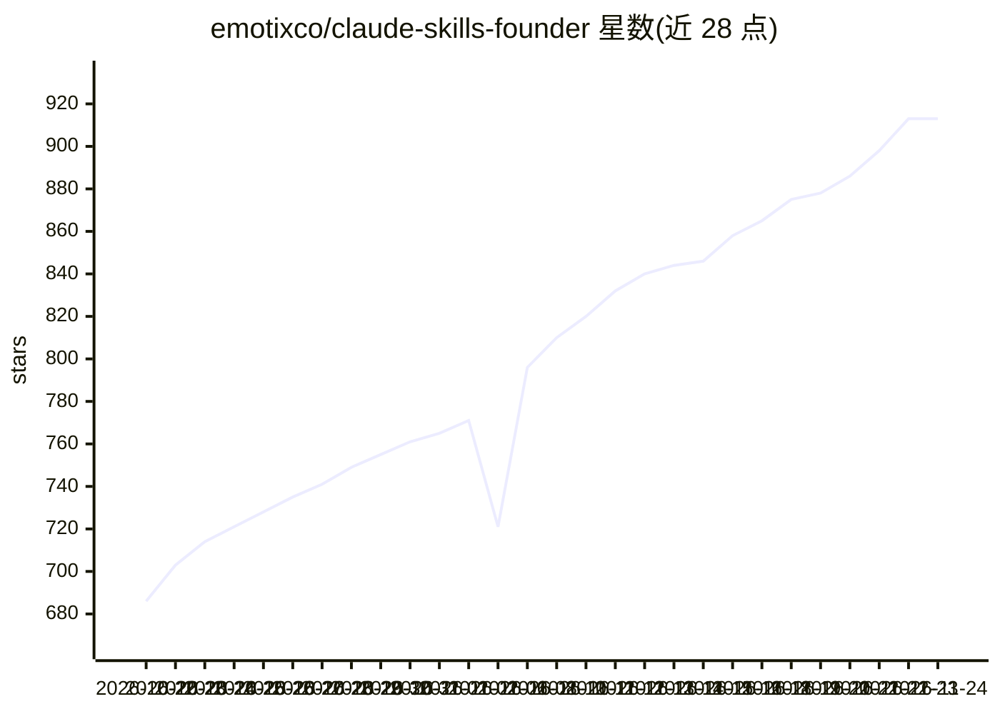

# emotixco/claude-skills-founder

⭐ 919 · Markdown · MIT · 推送 2026-11-03 · [GitHub](https://github.com/emotixco/claude-skills-founder) · 组织维护

**给创业者的 Claude Code 技能包：从想法到 GTM/融资文档**

面向创业者的 Claude Code 技能插件，含 14 个斜杠命令，覆盖想法验证、产品简报、竞品矩阵、用户画像、定价策略、GTM 计划、Pitch Deck、融资准备与指标看板等。各技能将输出保存到项目内 founder/ 文件夹并被后续技能复用；外部事实附来源链接，找不到时标注 Estimate/Not found，用户自有数据缺失时生成占位符。通过 plugin marketplace 或 git clone 安装，MIT 许可，README 公布了与裸 Claude 对比的评测结果（部分模型上多数场景无差异）。

## 筛选速览

| 维度 | 判定 | 备注 |
|---|---|---|
| AI 角色 | `ai-native` | 本体是模型或模型工具 |
| 许可风险 | `permissive` | MIT |
| 部署形态 | `None` |  |
| 模型依赖 | locked-api |  |
| 硬件要求 | — | 无带数字的原话,不猜 |
| 安装摩擦 | `low` | 无编译、无系统依赖或容器化 |
| 成熟度 | — | 结构信号不足 |

## 能力要点

- 14 个斜杠命令技能，输出记分卡/表格/清单
- 技能间通过 founder/ 文件夹共享与复用数据
- 外部事实带来源链接，缺失数据以占位符呈现而非编造
- 附 examples/ 五个完整示例与 evals/ 评测基准

## 适用场景

- 对创业想法做多维度验证并得到 build/pivot/kill 结论
- 生成竞品对比表与定价分层策略
- 准备融资材料与 12 周融资时间线
- 撰写落地页文案与 onboarding 邮件序列

## 场景标签

`编码 Agent` `AI 写作` `模型评测` · 领域:编码与开发

## 证据(README 行号)

> L19: > Most Claude Code skill packs are developer tools: code review, git workflows, security audits. **This one is for 
> L31: |`/validate-idea`|Stress-test with 7-dimension scorecard|
> L82: /plugin marketplace add emotixco/claude-skills-founder

## 星数曲线

2026-10-22 686 → 2026-11-24 913（+227）

---
*卡片 v1 · prompt 1.4 · 生成 2026-11-24 · 置信度 high · 依据 README sha `f517a49d1a53` · [字段定义](../../DATASET.md)*
