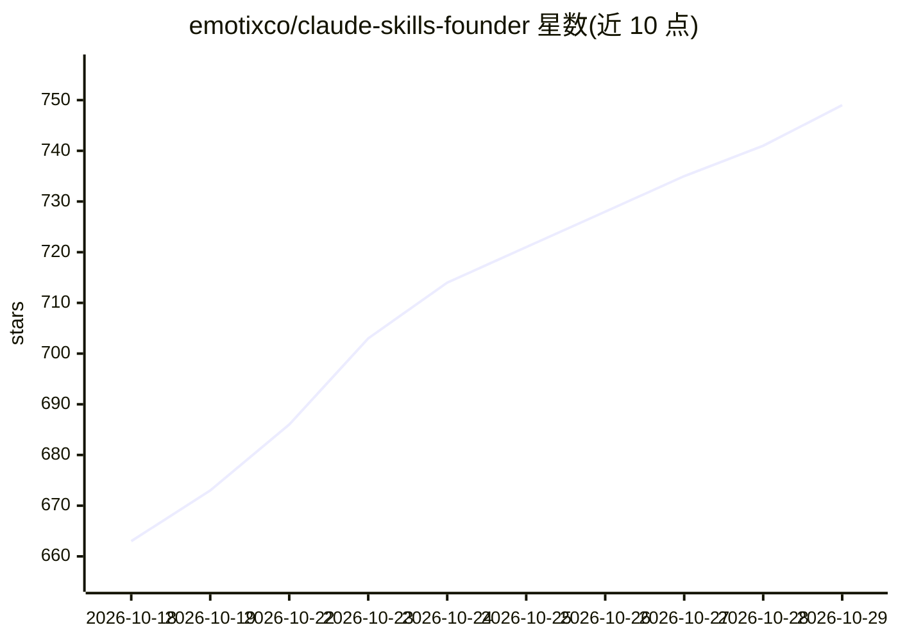

# emotixco/claude-skills-founder

⭐ 749 · Markdown · MIT · 推送 2026-10-20 · [GitHub](https://github.com/emotixco/claude-skills-founder) · 组织维护

**给创业者的 Claude Code 技能包：验证想法、定价、融资等 13 个斜杠命令**

由 Emotix 团队构建的 Claude Code 插件，提供 13 个面向创业场景的技能命令：想法验证评分卡、竞品矩阵、用户画像、MVP 裁剪、定价策略、GTM 计划、12 页融资路演大纲、募资准备与指标看板等。技能间通过项目内 founder/ 文件夹共享输出；外部事实（竞品价格、融资轮次）附来源链接，缺失数据标注为占位符而非编造。安装方式为 Claude Code 插件市场命令或 git clone 至 ~/.claude/skills。

## 筛选速览

| 维度 | 判定 | 备注 |
|---|---|---|
| AI 角色 | `ai-ecosystem` | LLM/agent 周边工具 |
| 许可风险 | `permissive` | MIT |
| 部署形态 | `None` |  |
| 模型依赖 | locked-api |  |
| 硬件要求 | — | 无带数字的原话,不猜 |
| 安装摩擦 | `low` | 无编译、无系统依赖或容器化 |
| 成熟度 | — | 结构信号不足 |

## 能力要点

- 13 个创业场景技能命令（验证/策略/融资三组）
- 技能间通过 founder/ 文件夹读写共享数据
- 竞品价格等外部事实附来源链接，缺失数据用占位符
- evals/ 目录用 claude plugin eval 对比有无插件的表现

## 适用场景

- 在终端里对创业想法做 7 维评分验证
- 生成竞品对比矩阵与定价方案并保留来源链接
- 准备 12 页路演大纲与 12 周募资时间线

## 场景标签

`提示工程` · 领域:Agent 开发

## 证据(README 行号)

> L14: Claude Code
> L76: Inside Claude Code:
> L79: /plugin marketplace add emotixco/claude-skills-founder

## 星数曲线

2026-10-18 663 → 2026-10-29 749（+86）

---
*卡片 v1 · prompt 1.4 · 生成 2026-10-21 · 置信度 high · 依据 README sha `58f3a307345d` · [字段定义](../../DATASET.md)*
