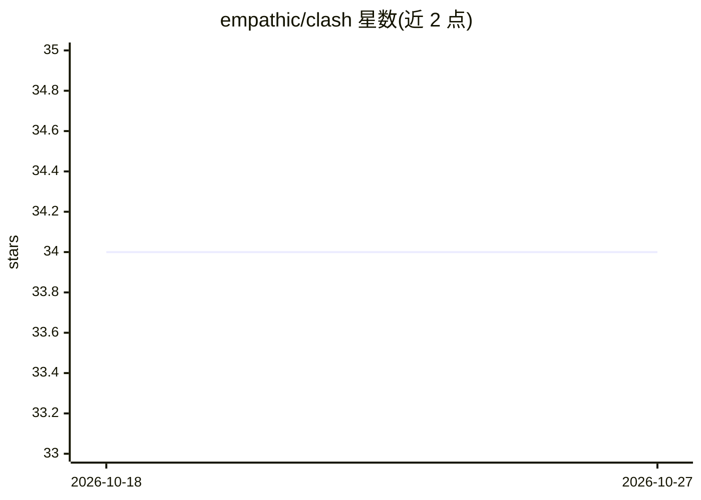

# empathic/clash

⭐ 34 · Rust · NOASSERTION · 推送 2026-05-14 · [GitHub](https://github.com/empathic/clash) · 组织维护

**给编码 agent 用户：命令行工具调用的安全策略管控框架**

面向执行工具调用的编码 agent（如 Claude Code）的安全策略层：通过 agent 插件钩子拦截每次工具调用，按 Starlark 编写的策略评估为 allow/deny/ask 三种结果，支持 exec/fs/net 能力分级；规则可编译为 OS 级沙箱（Linux Landlock、macOS Seatbelt）限制文件与网络访问。提供用户/项目/会话/框架四层策略优先级、状态栏计分板、诊断命令。Rust 实现，支持 Claude Code 完整集成，另有 5 种 agent 的协议适配；不支持 Windows，API 尚不稳定。

## 筛选速览

| 维度 | 判定 | 备注 |
|---|---|---|
| AI 角色 | `ai-ecosystem` | LLM/agent 周边工具 |
| 许可风险 | `none` | NOASSERTION |
| 部署形态 | `library` | 以包/库形式分发 |
| 模型依赖 | — | README 未给出锁定关系 |
| 硬件要求 | — | 无带数字的原话,不猜 |
| 安装摩擦 | `low` | 无编译、无系统依赖或容器化 |
| 成熟度 | `idea` | |

## 能力要点

- Starlark 策略语言编译为 JSON IR，每次工具调用时评估、即时生效
- 规则可编译为 OS 级内核沙箱（Landlock/Seatbelt）
- 支持 Claude Code 及 5 种其他编码 agent 的协议适配（`--agent` 标志）
- 状态栏实时显示允许/拒绝/询问计数与最近决策

## 适用场景

- 为我的编码 agent 设置细粒度工具权限，替代全有或全无的批准模式
- 在项目内共享团队统一的安全策略
- 用内核沙箱限制允许命令的文件与网络访问范围

## 场景标签

`网络安全` · 领域:学习与行业

## 证据(README 行号)

> L278: Clash integrates with coding agents via their plugin or extension system. For each supported agent, an integration
> L281: Agent → integration hook → clash binary → policy evaluation → allow / deny / ask
> L12: Clash is designed to be **agent-agnostic** — a universal safety harness for any coding agent that executes tools on

## 星数曲线

2026-10-18 34 → 2026-10-27 34（+0）

---
*卡片 v1 · prompt 1.4 · 生成 2026-10-25 · 置信度 high · 依据 README sha `94a91991dc7b` · [字段定义](../../DATASET.md)*
