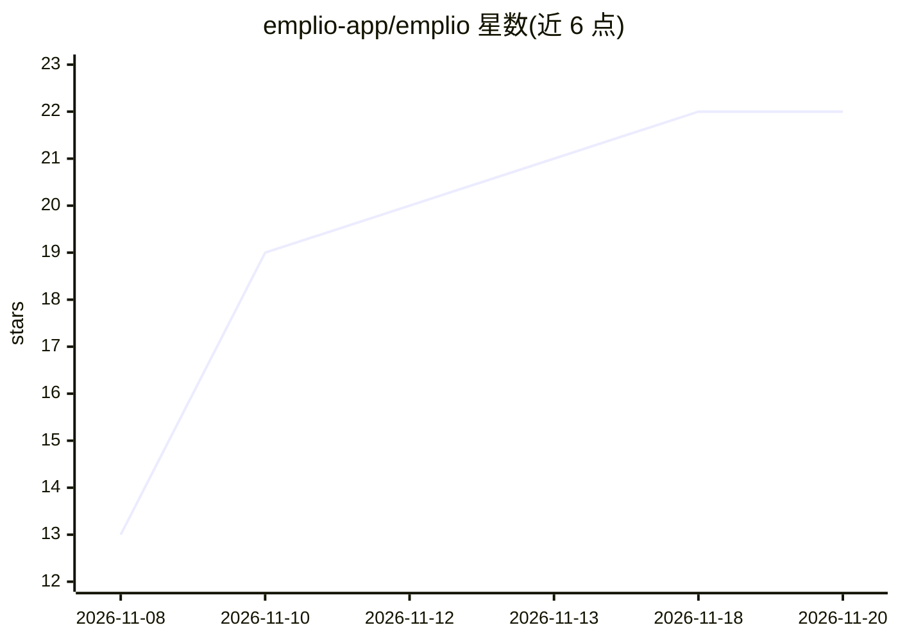

# emplio-app/emplio

⭐ 22 · TypeScript · AGPL-3.0 · 推送 2026-11-19 · [GitHub](https://github.com/emplio-app/emplio) · [官网](https://emplio.app) · 组织维护

**给整个团队共享的开源 AI 员工，自动干活并自我学习**

面向企业团队的自托管 AI 员工应用：团队成员通过网页、Telegram 或桌面应用与其对话，它在自己专属的容器计算机与浏览器中执行任务。架构上采用管理者-工作者模式：主对话作为管理者通过 hand-off 派发任务、核验结果，自动创建具名 agent；记忆以 git 仓库（Gitea）存储，支持 diff 与回滚；技能与工具由其自行编写保存。模型仅通过 OpenRouter 接入（默认组合为 Claude Sonnet 管理、Claude Haiku 执行）。需 Docker 部署，计划 4GB 内存加每人 2GB。当前限制：仅 OpenRouter 一个模型提供商、部分应用仍需 Composio、桌面应用较新。

## 筛选速览

| 维度 | 判定 | 备注 |
|---|---|---|
| AI 角色 | `ai-native` | 本体是模型或模型工具 |
| 许可风险 | `viral` | AGPL-3.0 |
| 部署形态 | `self-host` | docker 或自建部署 |
| 模型依赖 | locked-api |  |
| 硬件要求 | — | 无带数字的原话,不猜 |
| 安装摩擦 | `low` | 无编译、无系统依赖或容器化 |
| 成熟度 | `idea` | |

## 能力要点

- 管理者-工作者 agent 架构：hand-off 派发、结果核验、自动创建具名 agent
- 记忆以 git 仓库存储，提供 diff、历史与回滚
- 每人独立容器与 Docker 网络隔离，凭据不进入沙箱
- 自行编写并保存技能与工具，重复工作一次完成下次单调用复用

## 适用场景

- 团队共享一个 AI 员工处理研究、开票、跟进等日常业务
- 让它自动执行浏览器与命令行任务并按审批规则操作企业应用
- 把业务规则与经验沉淀为团队共享的 git 记忆

## 场景标签

`AI 助手` `浏览器自动化` · 领域:效率与自动化

## 证据(README 行号)

> L14: Emplio is one agent for a whole business. Everyone on the team talks to it, on the web, on Telegram or in the deskt
> L104: - **Talk to it:** the web app, a Telegram bot, desktop apps for Mac, Windows and Linux, and an iPhone app for Empl
> L123: Emplio thinks with a model through OpenRouter, so the model company sees what it works on:

## 星数曲线

2026-11-08 13 → 2026-11-20 22（+9）

---
*卡片 v1 · prompt 1.4 · 生成 2026-11-18 · 置信度 high · 依据 README sha `70bce2f9ff40` · [字段定义](../../DATASET.md)*
