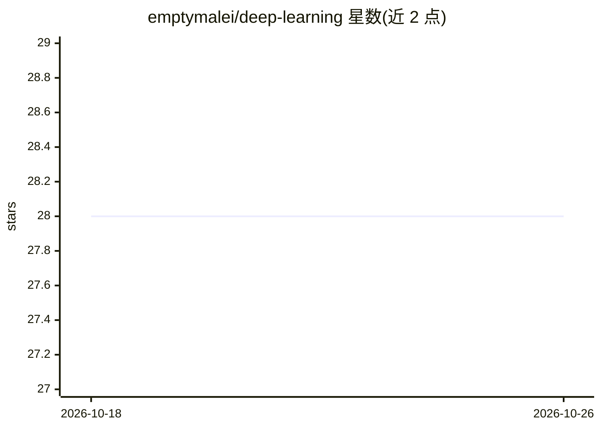

# emptymalei/deep-learning

⭐ 28 · Python · 推送 2026-06-04 · [GitHub](https://github.com/emptymalei/deep-learning) · [官网](https://emptymalei.github.io/deep-learning) · 个人维护

**个人深度学习时间序列预测的学习笔记与文档仓库**

作者个人知识整理仓库：以 markdown 文件组织深度学习（含时间序列预测、生成模型、对比学习、自监督学习等主题）的学习内容，定位为在数字花园 datumorphism 碎片笔记基础上构建成体系的故事化内容。仓库本身不提供可运行的模型代码作为产品，主要交付物是文档；通过 MkDocs 预览，jupytext 同步 .py 与 .ipynb 笔记，pre-commit 做 markdown 规范检查。PDF 生成依赖 cairo、Pango、GDK-PixBuf。面向关注深度学习与时间序列预测的学习者和研究者。

## 筛选速览

| 维度 | 判定 | 备注 |
|---|---|---|
| AI 角色 | `ai-knowledge` | 知识聚合/清单类 |
| 许可风险 | `none` | — |
| 部署形态 | `None` |  |
| 模型依赖 | — | README 未给出锁定关系 |
| 硬件要求 | — | 无带数字的原话,不猜 |
| 安装摩擦 | `low` | 无编译、无系统依赖或容器化 |
| 成熟度 | — | 结构信号不足 |

## 能力要点

- MkDocs 文档站点本地预览（poetry 管理依赖）
- jupytext 同步 .py 与 .ipynb 开发笔记
- pre-commit 集成 markdownlint 保证 markdown 规范
- mkdocs-with-pdf 插件生成 PDF

## 适用场景

- 学习深度学习与时间序列预测的系统化笔记
- 作为个人知识管理（数字花园）的成体系补充
- 按主题（GAN、对比学习、自监督等）查阅学习材料

## 场景标签

`教程课程` `知识库管理` · 领域:知识与检索

## 证据(README 行号)

> L3: When I switched to data science, I built my digital garden, datumorphism. I deliberately designed this digital garde
> L5: Making bricks is easy but assembling them into a house is not. So I have decided to use this repository to practice 

## 星数曲线

2026-10-18 28 → 2026-10-26 28（+0）

---
*卡片 v1 · prompt 1.4 · 生成 2026-10-26 · 置信度 mid · 依据 README sha `8eb996d1270a` · [字段定义](../../DATASET.md)*
