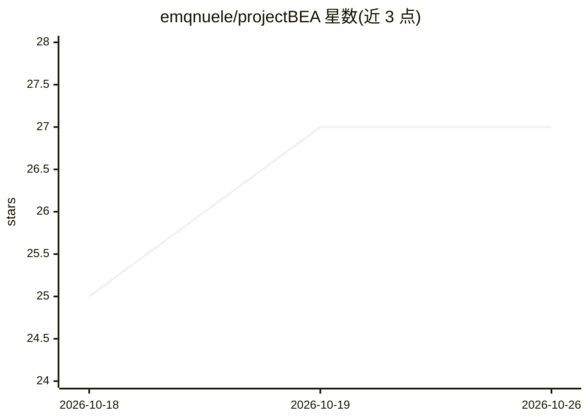

# emqnuele/projectBEA

⭐ 27 · Python · MIT · 推送 2026-10-24 · [GitHub](https://github.com/emqnuele/projectBEA) · [官网](https://projectbea.emqnuele.dev/) · 个人维护

**跨平台常驻 AI 虚拟人格引擎：在 Discord/Telegram/Twitch/Minecraft 中同一心智**

面向个人用户的常驻 AI 人格（persona）引擎：一个心智同时接入 Discord、Telegram、Twitch 聊天和原版 Minecraft 服务器，通过感知总线、注意力门控（按优先级批处理消息）、单一滑动上下文窗口（默认 150k 可调至 500k）与三层 SQLite 记忆（日记/人物卡/自我认知）驱动。本地模型即可运行，也可接 OpenRouter/OpenAI/Groq/Claude 等 API key。提供 FastAPI+React 控制台、OBS 直播形象（图片/VRM/VTube Studio）、技能插件架构与夜间自我整理。默认 API 无鉴权，仅绑定 127.0.0.1。

## 筛选速览

| 维度 | 判定 | 备注 |
|---|---|---|
| AI 角色 | `ai-native` | 本体是模型或模型工具 |
| 许可风险 | `permissive` | MIT |
| 部署形态 | `self-host` | docker 或自建部署 |
| 模型依赖 | local-ok | 支持本地模型 |
| 硬件要求 | — | 无带数字的原话,不猜 |
| 安装摩擦 | `low` | 无编译、无系统依赖或容器化 |
| 成熟度 | — | 结构信号不足 |

## 能力要点

- 一个心智同时运行于 Discord/Telegram/Twitch/Minecraft 四个平台
- 注意力门控按优先级批处理消息，控制成本
- 三层记忆（日记/人物卡/自我认知）存于单一可检查的 SQLite 文件
- 插件式 Skill 架构，能力可在运行时开关
- 一条命令安装（uv 脚本），本地模型运行无需 API key

## 适用场景

- 搭建自己的常驻 AI 虚拟主播/虚拟人格
- 让 AI 在 Minecraft 服务器上作为玩家与真人互动
- 在多个聊天平台保留同一份记忆与人格对话

## 场景标签

`Agent 框架` `聊天机器人` `Agent 记忆` · 领域:Agent 开发

## 证据(README 行号)

> L7:  An always-on AI persona across Discord, Telegram, Twitch and a vanilla
> L25: A chatbot waits for a message and answers it. Bea does not wait.
> L240: Every one of these is a **Skill**: a plugin that can perceive, expose tools,

## 星数曲线

2026-10-18 25 → 2026-10-26 27（+2）

---
*卡片 v1 · prompt 1.4 · 生成 2026-10-26 · 置信度 high · 依据 README sha `06bae0556c5a` · [字段定义](../../DATASET.md)*
