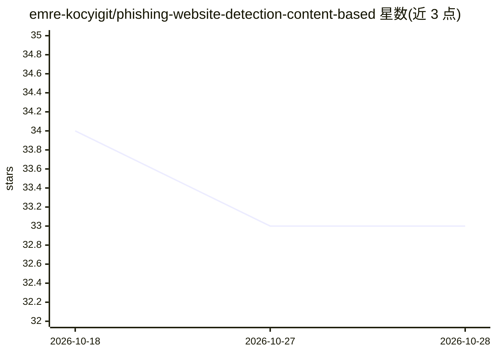

# emre-kocyigit/phishing-website-detection-content-based

⭐ 33 · Python · MIT · 推送 2026-06-03 · [GitHub](https://github.com/emre-kocyigit/phishing-website-detection-content-based) · 个人维护

**基于 HTML 内容特征的钓鱼网站检测 ML 流水线**

端到端机器学习项目：从 PhishTank 与 Tranco 列表采集钓鱼及合法网页，用 BeautifulSoup 解析 HTML 提取 30+ 个内容特征（标签计数、外部资源比例、表单属性等，不含 URL/域名信号），训练并比较五个分类器（Random Forest、AdaBoost、Decision Tree、Naive Bayes、SVM），采用 5 折交叉验证。仓库含预采集结构化数据 CSV，可通过 data_collector.py 用自有 URL 重建数据，另提供 Flask 应用对单个 URL 做预测。关联论文发表于 Elektronika ir Elektrotechnika 2022。

## 筛选速览

| 维度 | 判定 | 备注 |
|---|---|---|
| AI 角色 | `ai-native` | 本体是模型或模型工具 |
| 许可风险 | `permissive` | MIT |
| 部署形态 | `library` | 以包/库形式分发 |
| 模型依赖 | — | README 未给出锁定关系 |
| 硬件要求 | — | 无带数字的原话,不猜 |
| 安装摩擦 | `low` | 无编译、无系统依赖或容器化 |
| 成熟度 | — | 结构信号不足 |

## 能力要点

- 仅用 HTML 内容特征（30+ 二值与数值特征），不含 URL/域名信号
- 五个分类器 5 折交叉验证训练与比较，附带混淆矩阵
- 预采集数据集（钓鱼/合法各约 1 万条）随仓库提供
- Flask 应用支持对单个 URL 做预测

## 适用场景

- 我想训练一个基于页面内容的钓鱼网站分类器
- 我想用自己的 URL 列表重建钓鱼检测数据集
- 我想通过网页界面对单个 URL 做钓鱼预测

## 场景标签

`网络安全` · 领域:学习与行业

## 证据(README 行号)

> L3: End-to-end machine learning pipeline for detecting phishing websites using
> L30:  machine_learning.py

## 星数曲线

2026-10-18 34 → 2026-10-28 33（-1）

---
*卡片 v1 · prompt 1.4 · 生成 2026-10-25 · 置信度 mid · 依据 README sha `3055d0cfbcae` · [字段定义](../../DATASET.md)*
