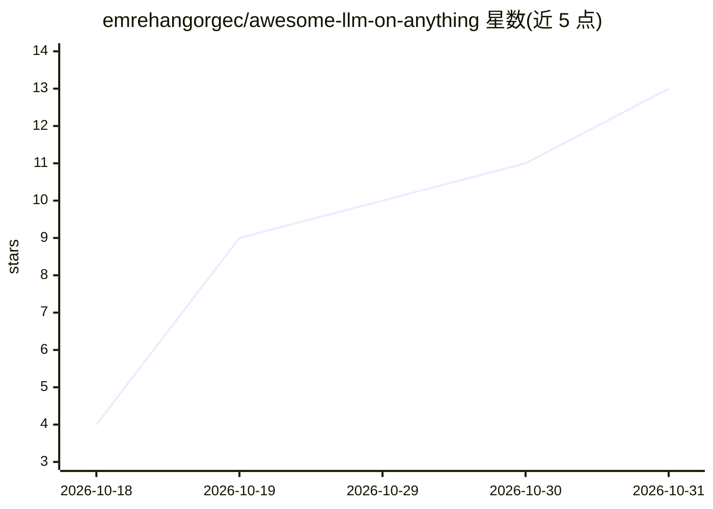

# emrehangorgec/awesome-llm-on-anything

⭐ 13 · CC0-1.0 · 推送 2026-10-30 · [GitHub](https://github.com/emrehangorgec/awesome-llm-on-anything) · 个人维护

**在复古电脑、游戏机与微控制器上本地运行 LLM 的项目清单**

收录在非主流硬件上真实本地推理 LLM 的移植项目清单，覆盖复古计算机（C64、486、Pentium II）、游戏机与掌机（N64、PS2、PSP、Switch、Xbox Series S）、微控制器（ESP32、RP2040/RP2350）与可穿戴设备，逐条列出设备、模型、作者报告的速度与项目链接。收录规则要求推理在设备本体真实硬件上运行，仅模拟器展示的条目与瘦客户端（模型在远端）单列；速度数字均来自移植作者报告，未重新测速。另含 Foundations、Wanted、Extremes 等栏目。

## 筛选速览

| 维度 | 判定 | 备注 |
|---|---|---|
| AI 角色 | `ai-knowledge` | 知识聚合/清单类 |
| 许可风险 | `viral` | CC0-1.0 |
| 部署形态 | `None` |  |
| 模型依赖 | — | README 未给出锁定关系 |
| 硬件要求 | — | 无带数字的原话,不猜 |
| 安装摩擦 | `low` | 无编译、无系统依赖或容器化 |
| 成熟度 | — | 结构信号不足 |

## 能力要点

- 按复古计算机/游戏机掌机/微控制器/可穿戴等类别组织条目
- 收录规则要求推理在本机真实硬件运行，模拟器展示与瘦客户端单列
- 每条含设备配置、模型、量化与作者报告的 tok/s 速度
- Wanted 栏目列出尚无文档化移植的设备（Game Boy、Kindle、图形计算器）

## 适用场景

- 查找某个老设备或微控制器上已有的 LLM 移植项目
- 了解极小硬件上运行 LLM 的模型规模与速度量级
- 为尚未被移植的设备寻找选题方向

## 场景标签

`精选清单` · 领域:学习与行业

## 证据(README 行号)

> L3: > Language models running locally on hardware that has no business running them.
> L7: **The one rule:** inference must run **on the device itself**, on real hardware. Devices that only talk to a model e

## 星数曲线

2026-10-18 4 → 2026-10-31 13（+9）

---
*卡片 v1 · prompt 1.4 · 生成 2026-10-31 · 置信度 high · 依据 README sha `cd2c5f07d9e0` · [字段定义](../../DATASET.md)*
