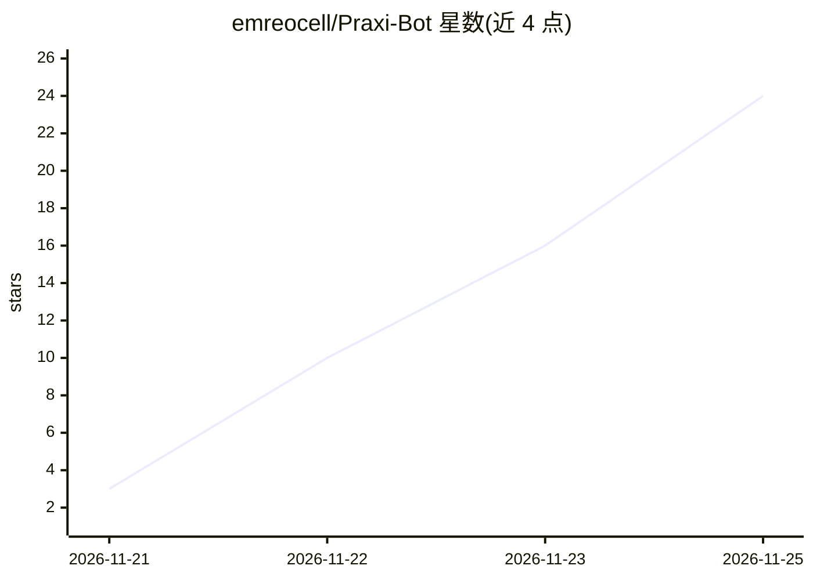

# emreocell/Praxi-Bot

⭐ 24 · Rust · Apache-2.0 · 推送 2026-11-24 · [GitHub](https://github.com/emreocell/Praxi-Bot) · 个人维护

**本地优先的开源桌面 AI agent 平台，权限引擎控制每一步操作**

基于 Rust（tokio/axum）与 Tauri 构建的本地优先自托管 AI agent 平台：本地 daemon 监听 127.0.0.1，用户通过桌面应用（Windows）、bot CLI 或 Telegram 与 bot 交互。bot 可读写文件、运行命令、驱动浏览器和操作桌面应用，所有工具调用经代码强制的权限引擎，变更操作默认需审批（Allow once/This chat/Always/Deny）。支持本地或云端模型、多 agent 工作流、MCP、定时任务（英文/土耳其语）。项目处于 alpha 阶段，无稳定 API。

## 筛选速览

| 维度 | 判定 | 备注 |
|---|---|---|
| AI 角色 | `ai-native` | 本体是模型或模型工具 |
| 许可风险 | `permissive` | Apache-2.0 |
| 部署形态 | `desktop` | 安装包/桌面程序 |
| 模型依赖 | local-ok | 支持本地模型 |
| 硬件要求 | — | 无带数字的原话,不猜 |
| 安装摩擦 | `low` | 无编译、无系统依赖或容器化 |
| 成熟度 | `idea` | |

## 能力要点

- 权限引擎由代码强制执行，模型无法绕过；金钱操作与危险 shell 命令始终需审批
- daemon 仅监听 127.0.0.1，无入站端口，无遥测，API key 存 OS keychain
- 支持 Windows/Linux(X11) 桌面控制与 Chromium DevTools 控制浏览器
- 支持本地（Ollama、LM Studio）或云端模型及任意 OpenAI 兼容服务

## 适用场景

- 让 agent 自动化处理文件、命令、浏览器等桌面任务，同时保留逐项审批控制
- 通过本地模型在离线/隐私敏感环境中运行 agent
- 用英文或土耳其语设置定时自动化任务
- 通过 Telegram 远程查看和审批 agent 操作

## 场景标签

`多智能体` `GUI 自动化` `浏览器自动化` · 领域:Agent 开发

## 证据(README 行号)

> L26: Praxi runs a local daemon (Rust, tokio and axum) on your machine. You chat with *bots* from a desktop app (Windows)
> L84: - **Permissions are enforced by code, not by the model.** Every tool call goes through a resolver; the model cannot

## 星数曲线

2026-11-21 3 → 2026-11-25 24（+21）

---
*卡片 v1 · prompt 1.4 · 生成 2026-11-22 · 置信度 mid · 依据 README sha `f42a032af8c8` · [字段定义](../../DATASET.md)*
