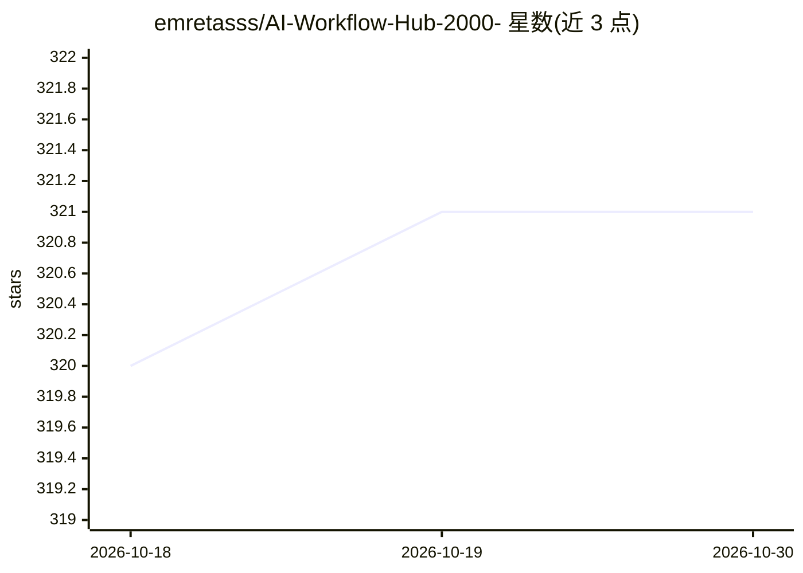

# emretasss/AI-Workflow-Hub-2000-

⭐ 321 · 推送 2026-07-17 · [GitHub](https://github.com/emretasss/AI-Workflow-Hub-2000-) · [官网](https://ai-workflow-hub-flax.vercel.app/) · 个人维护

**2000+ 免费 N8N AI 自动化工作流模板合集，可复制导入使用**

面向开发者、企业与自动化爱好者的 N8N 工作流模板集合，收录 2000+ 条 AI 自动化工作流 JSON 配置，使用方式为复制 JSON、导入 N8N 实例、配置 API 凭据后激活运行。工作流按 AI 与机器学习、数据处理、Web 自动化、通讯、业务流程 5 大类别组织，触发方式含手动、Webhook、定时与事件。README 另提供 Google Gemini、OpenAI、LangChain 等凭据配置说明及导入失败等故障排查指引。

## 筛选速览

| 维度 | 判定 | 备注 |
|---|---|---|
| AI 角色 | `ai-knowledge` | 知识聚合/清单类 |
| 许可风险 | `none` | — |
| 部署形态 | `None` |  |
| 模型依赖 | — | README 未给出锁定关系 |
| 硬件要求 | — | 无带数字的原话,不猜 |
| 安装摩擦 | `low` | 无编译、无系统依赖或容器化 |
| 成熟度 | — | 结构信号不足 |

## 能力要点

- 收录 2000+ 条 N8N 工作流 JSON，一键复制导入
- 按 5 大类别组织（AI/数据处理/Web 自动化/通讯/业务流程）
- 提供 Google Gemini、OpenAI、LangChain 凭据配置说明
- 触发类型覆盖 Manual/Webhook/Schedule/Event，分三档复杂度

## 适用场景

- 为 N8N 实例寻找现成的 AI 自动化工作流模板
- 快速搭建邮件、Slack、WhatsApp 等通讯自动化流程
- 参考工作流配置学习 N8N 自动化搭建方式

## 场景标签

`工作流自动化` `精选清单` · 领域:效率与自动化

## 证据(README 行号)

> L13: AI Workflow Hub is a collection of **2000+ free N8N AI automation workflows** designed to help developers, business
> L123: - **Total Workflows**: 2000+

## 星数曲线

2026-10-18 320 → 2026-10-30 321（+1）

---
*卡片 v1 · prompt 1.4 · 生成 2026-10-21 · 置信度 high · 依据 README sha `0e2858c70746` · [字段定义](../../DATASET.md)*
