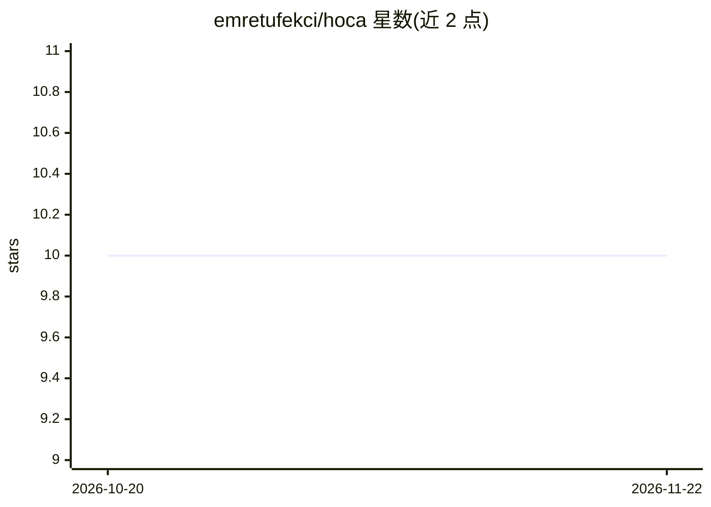

# emretufekci/hoca

⭐ 10 · JavaScript · MIT · 推送 2026-11-11 · [GitHub](https://github.com/emretufekci/hoca) · 个人维护

**输入主题，生成 3Blue1Brown 风格讲解视频的本地流水线**

Hoca 以一条命令把一个主题变成带旁白的动画讲解视频：AI 编码 agent（Claude Code 或 Codex CLI）负责研究主题、撰写旁白与 Manim 风格动画代码，语音与渲染在本地 CPU 完成，无 GPU 和语音 API 依赖。支持 11 种语言的本地语音（EMA Lightning、Kokoro、Piper），可选 Remotion/Blender 渲染引擎，输出含字幕的 MP4。以 Node 项目提供，含 MCP server 供编码 agent 以工具形式调用管线。

## 筛选速览

| 维度 | 判定 | 备注 |
|---|---|---|
| AI 角色 | `ai-native` | 本体是模型或模型工具 |
| 许可风险 | `permissive` | MIT |
| 部署形态 | `desktop` | 安装包/桌面程序 |
| 模型依赖 | local-ok | 支持本地模型 |
| 硬件要求 | — | 无带数字的原话,不猜 |
| 安装摩擦 | `medium` | 含编译或系统依赖之一 |
| 成熟度 | — | 结构信号不足 |

## 能力要点

- 一条命令生成含旁白与字幕的动画讲解视频
- 语音与逐帧渲染在本地 CPU 完成（无 GPU、无语音 API）
- 支持 Claude Code/Codex 等编码 agent 撰写脚本与动画，并提供 MCP server 接口
- 支持 11 种语言的本地语音与多语言字幕

## 适用场景

- 为学生制作某数学/技术概念的短视频讲解
- 把截图或流程图变成带旁白的说明视频
- 为 Reels/TikTok/Shorts 生成竖版科普内容

## 场景标签

`语音合成` `视频生成` · 领域:内容生成

## 证据(README 行号)

> L3: *Hoca* is Turkish for teacher (in English, "hodja"). Give Hoca a topic and it teaches it back as a short animated vi
> L79: - **Writer:** Claude Code (`AGENT=claude`) or Codex (`AGENT=codex`), neither of which needs an API key; or an API m
> L159: |Voice|EMA Lightning (Turkish), Kokoro (English, French, Italian, Portuguese, Spanish), Piper (German, Russian, Uk

## 星数曲线

2026-10-20 10 → 2026-11-22 10（+0）

---
*卡片 v1 · prompt 1.4 · 生成 2026-11-19 · 置信度 mid · 依据 README sha `dff877a178d3` · [字段定义](../../DATASET.md)*
