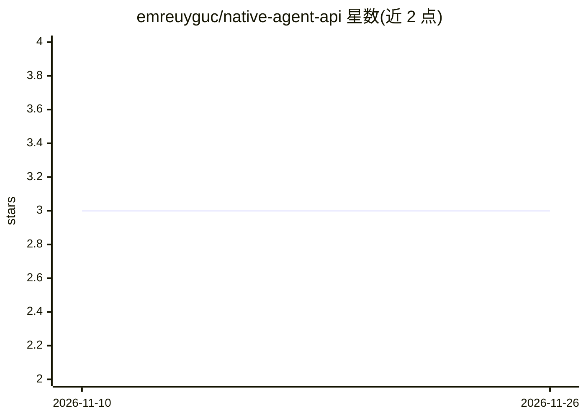

# emreuyguc/native-agent-api

⭐ 3 · Go · Apache-2.0 · 推送 2026-11-21 · [GitHub](https://github.com/emreuyguc/native-agent-api) · 个人维护

**自托管 HTTP 网关：把 Claude Code/Codex CLI 变成 REST/SSE/WebSocket 服务**

自托管网关，运行真实的 Claude Code 或 Codex CLI，并通过 REST、SSE 与 WebSocket 对外提供接口。会话、登录、工具、技能、hooks、插件、subagents 与 MCP servers 在服务化后保持原生行为。提供运行管理（一次性提问/交互式运行）、权限审批、托管工作区、token 认证与 IP 白名单等安全机制、OpenAPI 3.1 文档。一个网关进程服务一个 agent，两个进程可挂接同一目录协作。当前处于 0.x 阶段，API 在 minor 版本间可能变动；使用需自备订阅登录，需遵守 provider 条款。

## 筛选速览

| 维度 | 判定 | 备注 |
|---|---|---|
| AI 角色 | `ai-ecosystem` | LLM/agent 周边工具 |
| 许可风险 | `permissive` | Apache-2.0 |
| 部署形态 | `library` | 以包/库形式分发 |
| 模型依赖 | — | README 未给出锁定关系 |
| 硬件要求 | — | 无带数字的原话,不猜 |
| 安装摩擦 | `low` | 无编译、无系统依赖或容器化 |
| 成熟度 | `idea` | |

## 能力要点

- 驱动 CLI 原生协议，事件原样透传，不重新实现 agent
- REST/SSE/WebSocket 三种接口，事件流断线重连不丢失
- 客户端逐条审批工具调用权限（单次/会话/工作区粒度）
- 统一 API 覆盖两个 agent，typed provider 区分 agent 专属数据

## 适用场景

- 从 Web/移动应用或脚本远程调用服务器上的 coding agent
- 复用已有订阅驱动个人工具链而无需 API key
- 在无终端界面的环境下管理 agent 登录、模型与诊断

## 场景标签

`编码 Agent` · 领域:编码与开发

## 证据(README 行号)

> L7: **An HTTP API for Claude Code and Codex CLI.** native-agent-api runs the real coding-agent CLI and
> L30: native-agent-api turns the native CLI into a service:
> L39: - **One API for both agents.** Runs, sessions, events, permissions and usage look the same for

## 星数曲线

2026-11-10 3 → 2026-11-26 3（+0）

---
*卡片 v1 · prompt 1.4 · 生成 2026-11-22 · 置信度 high · 依据 README sha `39ad2f134860` · [字段定义](../../DATASET.md)*
