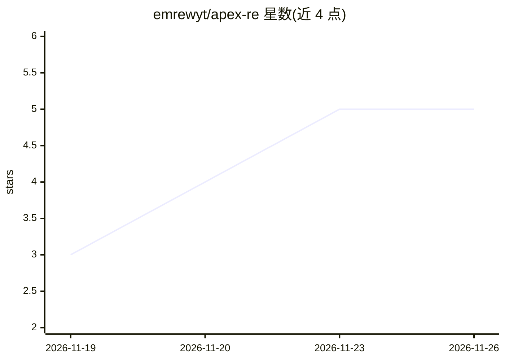

# emrewyt/apex-re

⭐ 5 · Python · MIT · 推送 2026-11-15 · [GitHub](https://github.com/emrewyt/apex-re) · 个人维护

**为 AI 编码 Agent 提供逆向工程技能包与分析脚本**

面向 AI 编码 Agent 的逆向工程技能集合，提供五层分析方法论：静态二进制分诊、动态内存快照对比、控制流反平坦化、多反编译器共识与等价性验证。内置六个零依赖 Python 工具（PE/ELF/Mach-O/WASM 解析、内存 diff、签名扫描、VM 字节码分析、Kaitai 格式合成、OLLVM 反平坦化）和覆盖 Unreal、Unity IL2CPP、Godot、.NET NativeAOT、Electron/Tauri 等目标的参考文档与 10 个英文/土耳其语 prompt 模板。通过一行安装脚本集成到 Antigravity 2.0、Claude Code、Codex、Cursor、Gemini CLI。

## 筛选速览

| 维度 | 判定 | 备注 |
|---|---|---|
| AI 角色 | `ai-knowledge` | 知识聚合/清单类 |
| 许可风险 | `permissive` | MIT |
| 部署形态 | `None` |  |
| 模型依赖 | — | README 未给出锁定关系 |
| 硬件要求 | — | 无带数字的原话,不猜 |
| 安装摩擦 | `high` | 编译与系统依赖俱全 |
| 成熟度 | — | 结构信号不足 |

## 能力要点

- 六个零依赖 Python 分析工具：分诊、内存 diff、签名扫描、VM 分析、Kaitai 合成、反平坦化
- 18 篇技术参考文档覆盖 Unreal/Unity/Godot/.NET/Electron 等目标
- 10 个英土双语 prompt 模板库
- 一行脚本集成多个 AI 编码 Agent

## 适用场景

- 让 AI Agent 分析游戏客户端二进制并重建结构体
- 对 OLLVM/VMProtect 混淆代码做反平坦化与去虚拟化
- 从内存快照 diff 合成 C++/C# 结构定义
- 为私有文件格式生成 Kaitai Struct 规范

## 场景标签

`网络安全` · 领域:学习与行业

## 证据(README 行号)

> L10: Agent Skill
> L63: The `skills/apex-re/scripts/` directory contains four zero-dependency Python tools:
> L100: Comprehensive documentation included in `skills/apex-re/references/`:

## 星数曲线

2026-11-19 3 → 2026-11-26 5（+2）

---
*卡片 v1 · prompt 1.4 · 生成 2026-11-21 · 置信度 high · 依据 README sha `19178908eb01` · [字段定义](../../DATASET.md)*
