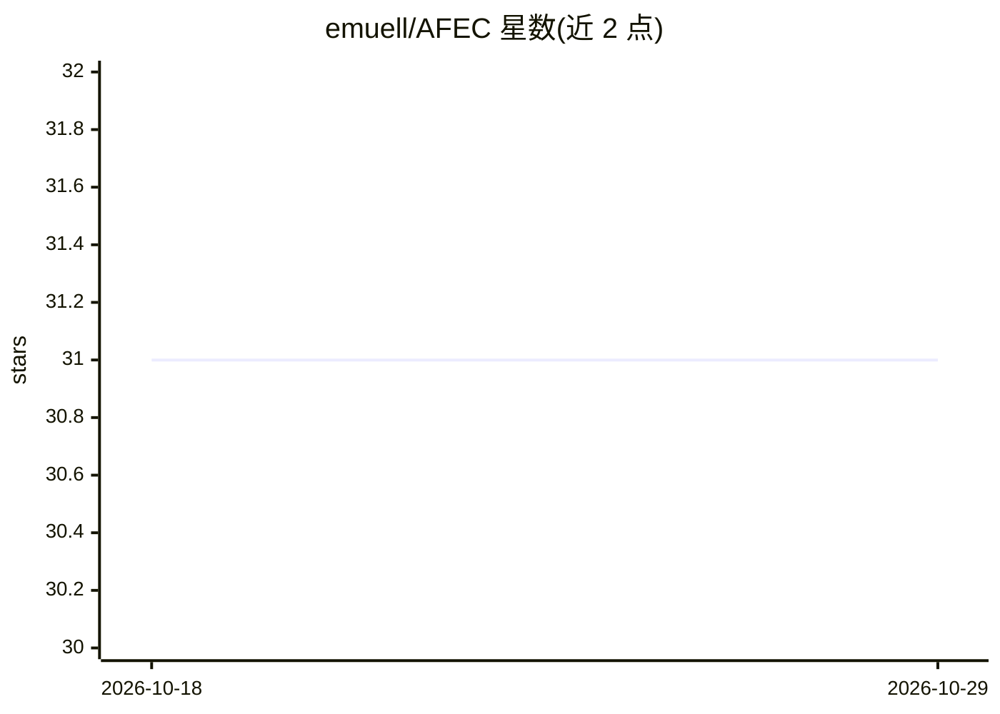

# emuell/AFEC

⭐ 31 · C++ · GPL-3.0 · 推送 2026-03-16 · [GitHub](https://github.com/emuell/AFEC) · 个人维护

**跨平台音频特征提取与声音分类 CLI 工具**

C++ 编写的命令行工具，分析音频文件（wav/aiff/flac/mp3/ogg 等 12 种格式）并将高低层音频特征写入 sqlite 数据库，覆盖 BPM、调性、谱特征、MFCC、节奏等。分类部分使用预训练的 LightGBM 梯度提升模型输出声音类别/类别签名，源码树中另含 ANN、SVM、KNN 等实验模型。从 Sononym 项目 1.0 版本分叉而来，不与其内部爬虫兼容。提供预编译二进制，也可从源码构建（需 cmake、git-lfs 等）。仅 CLI，无 GUI。

## 筛选速览

| 维度 | 判定 | 备注 |
|---|---|---|
| AI 角色 | `ai-native` | 本体是模型或模型工具 |
| 许可风险 | `viral` | GPL-3.0 |
| 部署形态 | `desktop` | 安装包/桌面程序 |
| 模型依赖 | — | README 未给出锁定关系 |
| 硬件要求 | — | 无带数字的原话,不猜 |
| 安装摩擦 | `medium` | 含编译或系统依赖之一 |
| 成熟度 | — | 结构信号不足 |

## 能力要点

- 分析 12 种音频格式并写入 sqlite 数据库
- 预训练 LightGBM 模型输出声音类别与类别签名
- 提取 BPM/调性/谱特征/MFCC/节奏等多组特征
- 附 ModelCreator 脚本用于训练与测试分类模型

## 适用场景

- 给采样库整理与检索提供音频特征数据
- 批量分析音频文件的声音类别与音乐属性
- 实验与训练音频分类模型

## 场景标签

 · 领域:音频/机器学习

## 证据(README 行号)

> L7: AFEC is a cross platform **audio feature extraction** and **sound classification** CLI tool written in C++. It analy
> L17: ACEC is using a subset of the analyzed low-level audio-features to evaluate a pretrained, bootstrap aggregated grad

## 星数曲线

2026-10-18 31 → 2026-10-29 31（+0）

---
*卡片 v1 · prompt 1.4 · 生成 2026-10-26 · 置信度 high · 依据 README sha `9576af21fff2` · [字段定义](../../DATASET.md)*
