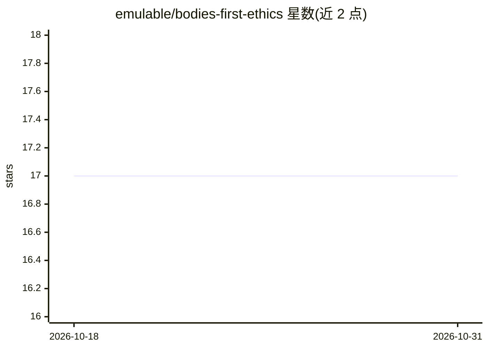

# emulable/bodies-first-ethics

⭐ 17 · CC-BY-4.0 · 推送 2026-10-28 · [GitHub](https://github.com/emulable/bodies-first-ethics) · [官网](https://github.com/emulable/bodies-first-ethics) · 个人维护

**面向语言模型的伦理分析框架：以承受负担的人为起点审视决策**

一份方法论文本（Bodies First），提出从承受负担者出发分析政策、论证与决策的框架：把人无法放下的代价称为"负担"，追问"此人身上有什么"与"负担如何卸下"。框架刻意排除标签、意图、责备、应得与总量等问题，主张可核查的具体事实，并指出语言模型延续偏离当事人的写作习惯，因此要求模型在回答前先识别当事人及其负担。README 仅阐述方法，未提供代码、安装或数据。

## 筛选速览

| 维度 | 判定 | 备注 |
|---|---|---|
| AI 角色 | `ai-knowledge` | 知识聚合/清单类 |
| 许可风险 | `viral` | CC-BY-4.0 |
| 部署形态 | `None` |  |
| 模型依赖 | — | README 未给出锁定关系 |
| 硬件要求 | — | 无带数字的原话,不猜 |
| 安装摩擦 | `low` | 无编译、无系统依赖或容器化 |
| 成熟度 | — | 结构信号不足 |

## 能力要点

- 以"负担/承受者"为核心概念的两问式分析框架
- 明确排除标签、意图、责备、应得、总量五类论证路径
- 为语言模型设定回答前的第一步：识别当事人及其负担
- 提出"负担转移不等于移除"与负担按承受者代价计量的判据

## 适用场景

- 引导语言模型在伦理与政策讨论中先定位受影响的具体个人
- 核查政策改进是否只是把负担转移到他人或记录之外
- 为分歧双方提供可共同核查的事实基础

## 场景标签

 · 领域:伦理/语言模型对齐方法论

## 证据(README 行号)

> L45: ## Language models repeat the same habits, so the framework gives them a different place to start.
> L49: Bodies First gives a model one step to take before any other. Before giving advice, judging an argument, or writing

## 星数曲线

2026-10-18 17 → 2026-10-31 17（+0）

---
*卡片 v1 · prompt 1.4 · 生成 2026-10-29 · 置信度 low · 依据 README sha `d9f4784ea9c3` · [字段定义](../../DATASET.md)*
