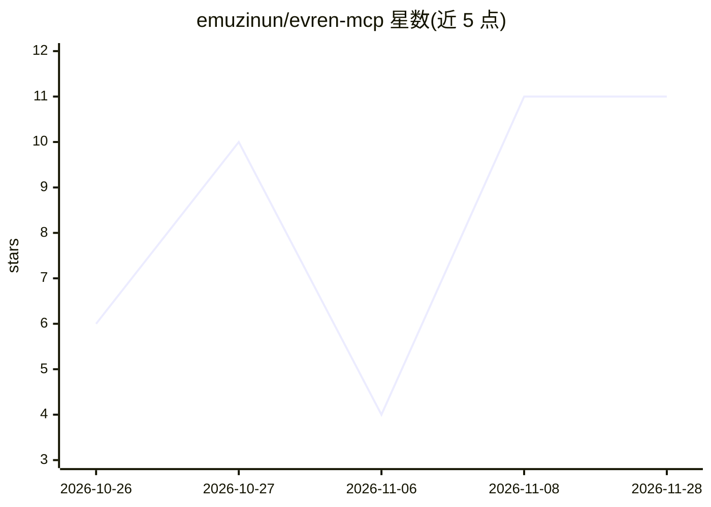

# emuzinun/evren-mcp

⭐ 11 · Python · MIT · 推送 2026-11-14 · [GitHub](https://github.com/emuzinun/evren-mcp) · 个人维护

**把 EVREN AI 平台接入 Claude Code 的非官方 MCP 服务器**

非官方社区项目：通过 MCP 协议把土耳其 EVREN AI 平台接入 Claude Code，提供数据集查询、模型搜索、费用估算、训练启动/停止、模型评估与下载等 13 个工具。核心机制是费用审批门：训练前必须先取得一次性有效 10 分钟的报价，经用户确认并依次通过单任务与每日信用额度上限后才执行；启动失败不重发以防重复扣费。需 EVREN 账号与平台 API key，经 uv/uvx 运行。

## 筛选速览

| 维度 | 判定 | 备注 |
|---|---|---|
| AI 角色 | `ai-ecosystem` | LLM/agent 周边工具 |
| 许可风险 | `permissive` | MIT |
| 部署形态 | `None` |  |
| 模型依赖 | — | README 未给出锁定关系 |
| 硬件要求 | — | 无带数字的原话,不猜 |
| 安装摩擦 | `low` | 无编译、无系统依赖或容器化 |
| 成熟度 | — | 结构信号不足 |

## 能力要点

- estimate_training→报价→用户确认→start_training 的强制审批流程
- 单任务与每日信用额度双上限（默认 5 CR / 20 CR，可配置）
- 13 个 MCP 工具与两个预设流程（egit/durum）
- API key 仅走 HTTPS 且在输出中掩码，本地限速 20 请求/分钟

## 适用场景

- 从 Claude Code 用自然语言启动 EVREN 平台上的模型训练并控制花费
- 训练前查看最坏情况成本估算并获得报价
- 查询平台数据集、公开模型与账户信用余额

## 场景标签

 · 领域:MLOps/模型训练平台接入

## 证据(README 行号)

> L9: **EVREN Yapay Zeka Platformu**'nu Claude Code'a bağlayan bir
> L16: uygular.
> L85: |`start_training`|Teklifle eğitimi başlatır|**kredi**|

## 星数曲线

2026-10-26 6 → 2026-11-28 11（+5）

---
*卡片 v1 · prompt 1.4 · 生成 2026-11-18 · 置信度 high · 依据 README sha `dd91f401c3cb` · [字段定义](../../DATASET.md)*
