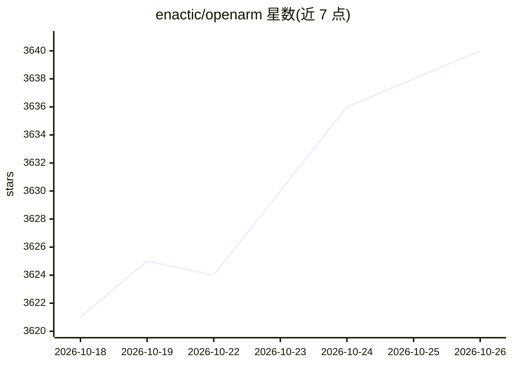

# enactic/openarm

⭐ 3,640 · MDX · Apache-2.0 · 推送 2026-10-23 · [GitHub](https://github.com/enactic/openarm) · [官网](https://openarm.dev) · 组织维护

**开源 7DOF 人形机械臂，用于物理 AI 研究与部署**

Enactic 维护的开源 7 自由度人形机械臂项目，面向接触丰富环境下的物理 AI 研究与部署。整套系统由多个仓库组成：硬件 CAD/BOM（CERN-OHL-S-2.0）、URDF 描述、CAN 电机控制库、ROS 2/MoveIt 包、MuJoCo 与 Isaac Lab 仿真环境、数据集格式（含 LeRobot 转换）以及基于 dora-rs 的遥操作/数据采集/策略推理节点。完整双手系统定价 $6,500，同时提供标准化实验环境 OpenArm Cell 以支持研究复现，并设有整机购买渠道。KER 为无电机主臂用于遥操作教程。

## 筛选速览

| 维度 | 判定 | 备注 |
|---|---|---|
| AI 角色 | `ai-native` | 本体是模型或模型工具 |
| 许可风险 | `permissive` | Apache-2.0 |
| 部署形态 | `None` |  |
| 模型依赖 | — | README 未给出锁定关系 |
| 硬件要求 | — | 无带数字的原话,不猜 |
| 安装摩擦 | `low` | 无编译、无系统依赖或容器化 |
| 成熟度 | — | 结构信号不足 |

## 能力要点

- 7DOF 人形臂，高背驱性与柔顺性设计，双手完整系统 $6,500
- 覆盖硬件 CAD、CAN 控制、ROS 2/MoveIt、MuJoCo/Isaac Lab 仿真的多仓库体系
- 基于 dora-rs 的数据流遥操作、数据采集与策略推理节点，可在真机与 MuJoCo 间切换
- 数据集格式含 LeRobot 转换，支持模仿学习与真机数据采集

## 适用场景

- 搭建低成本双手遥操作平台进行模仿学习数据采集
- 在 MuJoCo/Isaac Lab 中仿真训练策略并真机部署评估
- 在标准化的 OpenArm Cell 环境中做可复现的物理 AI 研究

## 场景标签

 · 领域:机器人/具身智能

## 证据(README 行号)

> L3: **OpenArm** is an open-source 7DOF humanoid arm designed for physical AI research and deployment in contact-rich env
> L9: OpenArm features **human-scale** proportions, safety and compliance, and practical payloads. At $6,500 USD for a com
> L47: The tutorial runs on dora-rs. Each `dora-openarm-*` repository is one node; a dataflow YAML wires nodes together an

## 星数曲线

2026-10-18 3,621 → 2026-10-26 3,640（+19）

---
*卡片 v1 · prompt 1.4 · 生成 2026-10-20 · 置信度 mid · 依据 README sha `0f5934463390` · [字段定义](../../DATASET.md)*
