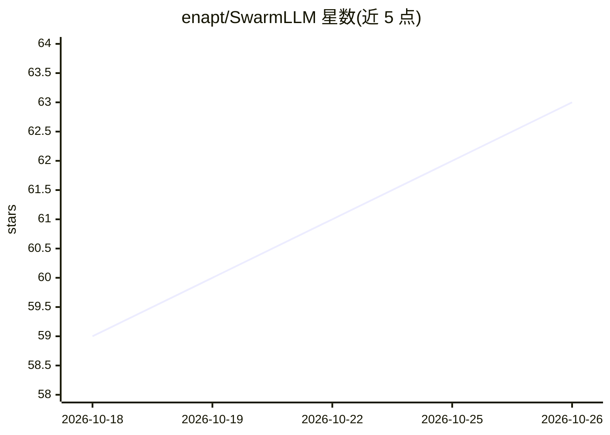

# enapt/SwarmLLM

⭐ 63 · Rust · Apache-2.0 · 推送 2026-10-25 · [GitHub](https://github.com/enapt/SwarmLLM) · [官网](https://enapt.github.io/SwarmLLM/) · 组织维护

**多机协作运行本地大模型的开源应用，兼作 ChatGPT 式聊天**

在用户自己电脑上运行开源聊天模型（Llama、Qwen、Gemma 等），并提供 OpenAI/Anthropic 兼容 API 供已有聊天应用、编码助手接入。核心机制是把模型按层切分，多台电脑经互联网（无中心服务器，libp2p）各持一部分接力完成推理，从而运行单机装不下的大模型；可组私人设备组或加入公共 swarm。提供 Windows/macOS/Linux 预编译包，无需账户；当前 swarm 只能跑中等规模模型，公共 swarm 下参与计算的机器可看到请求内容，不适用于敏感信息。

## 筛选速览

| 维度 | 判定 | 备注 |
|---|---|---|
| AI 角色 | `ai-ecosystem` | LLM/agent 周边工具 |
| 许可风险 | `permissive` | Apache-2.0 |
| 部署形态 | `desktop` | 安装包/桌面程序 |
| 模型依赖 | — | README 未给出锁定关系 |
| 硬件要求 | — | 无带数字的原话,不猜 |
| 安装摩擦 | `high` | 编译与系统依赖俱全 |
| 成熟度 | `idea` | |

## 能力要点

- 模型按层切分、多机接力运行的分布式推理，无中心服务器
- 提供 OpenAI 与 Anthropic 兼容 API，可替代接入 ChatGPT/Claude 的应用
- Private Mode、磁盘/带宽限额、资源调度等共享控制项
- Windows/macOS/Linux 预编译二进制，自动更新

## 适用场景

- 在本机离线运行开源聊天模型，不依赖云服务
- 把笔记本、台式机、家庭服务器组成私有大机器跑更大的模型
- 让支持 ChatGPT/Claude 的应用改用本地 SwarmLLM 作为后端
- 加入公共 swarm 贡献闲置算力换取运行更大模型

## 场景标签

`推理引擎` `聊天机器人` · 领域:对话与助手

## 证据(README 行号)

> L115: An AI model is built from a stack of layers. SwarmLLM cuts a model into parts,
> L194: **How is this different from Ollama or LM Studio?** They run AI on one
> L105:  AI agents that work with ChatGPT or Claude can use SwarmLLM instead —

## 星数曲线

2026-10-18 59 → 2026-10-26 63（+4）

---
*卡片 v1 · prompt 1.4 · 生成 2026-10-24 · 置信度 high · 依据 README sha `f1ae19984788` · [字段定义](../../DATASET.md)*
