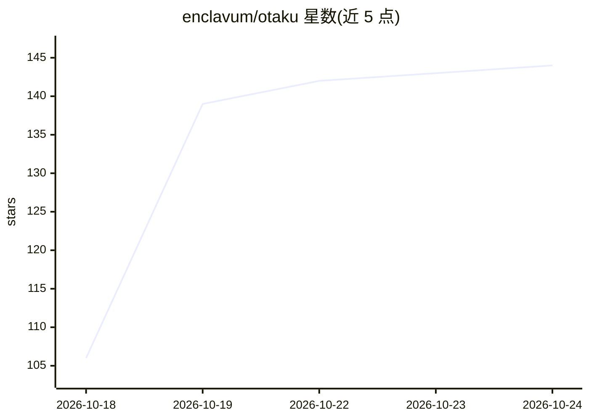

# enclavum/otaku

⭐ 143 · Python · AGPL-3.0 · 推送 2026-10-24 · [GitHub](https://github.com/enclavum/otaku) · [官网](https://otaku.sh) · 个人维护

**面向创意写作与角色扮演的本地 LLM 前端**

运行在用户本机的 LLM 前端应用，用于对话式角色扮演与小说式写作。支持本地后端（llama.cpp、KoboldCpp、Ollama、oMLX、LM Studio）或云端 API（OpenRouter、NanoGPT 及任意 OpenAI 兼容服务）。核心机制：首 20 条与末 150 条消息原文发送以保持文风，中间消息自动按场景摘要以压缩上下文；支持角色卡与 SillyTavern 聊天导入、故事分支、模型可调用的工具（提问/私密笔记/联网搜索）。提供终端与 Web 双界面，Web 默认仅本机访问，可配置 HTTPS 与密码。

## 筛选速览

| 维度 | 判定 | 备注 |
|---|---|---|
| AI 角色 | `ai-native` | 本体是模型或模型工具 |
| 许可风险 | `viral` | AGPL-3.0 |
| 部署形态 | `library` | 以包/库形式分发 |
| 模型依赖 | local-ok | 支持本地模型 |
| 硬件要求 | — | 无带数字的原话,不猜 |
| 安装摩擦 | `low` | 无编译、无系统依赖或容器化 |
| 成熟度 | — | 结构信号不足 |

## 能力要点

- 上下文压缩：中间消息自动按场景摘要，/context 可查看实际发送内容
- 角色库、角色自动抽取与每角色日记（journal）
- 角色卡 / SillyTavern 聊天 / 纯文本导入，故事可从任意消息分叉
- 模型可用工具：选择题提问、助手私密笔记、联网搜索

## 适用场景

- 与本地或云端 LLM 进行长篇角色扮演并保持文风一致
- 导入已有角色卡或 SillyTavern 聊天继续游玩
- 以小说模式直接在转写中续写故事

## 场景标签

`聊天机器人` `AI 写作` · 领域:对话与助手

## 证据(README 行号)

> L1: # otaku — an LLM frontend for creative writing and roleplay
> L8: Otaku is free and open source, runs on your own computer, needs no infrastructure, installs in one
> L88: Providers supported: llama.cpp, KoboldCpp, Ollama, oMLX, LM Studio; OpenRouter and

## 星数曲线

2026-10-18 106 → 2026-10-24 144（+38）

---
*卡片 v1 · prompt 1.4 · 生成 2026-10-22 · 置信度 high · 依据 README sha `554437052e6f` · [字段定义](../../DATASET.md)*
