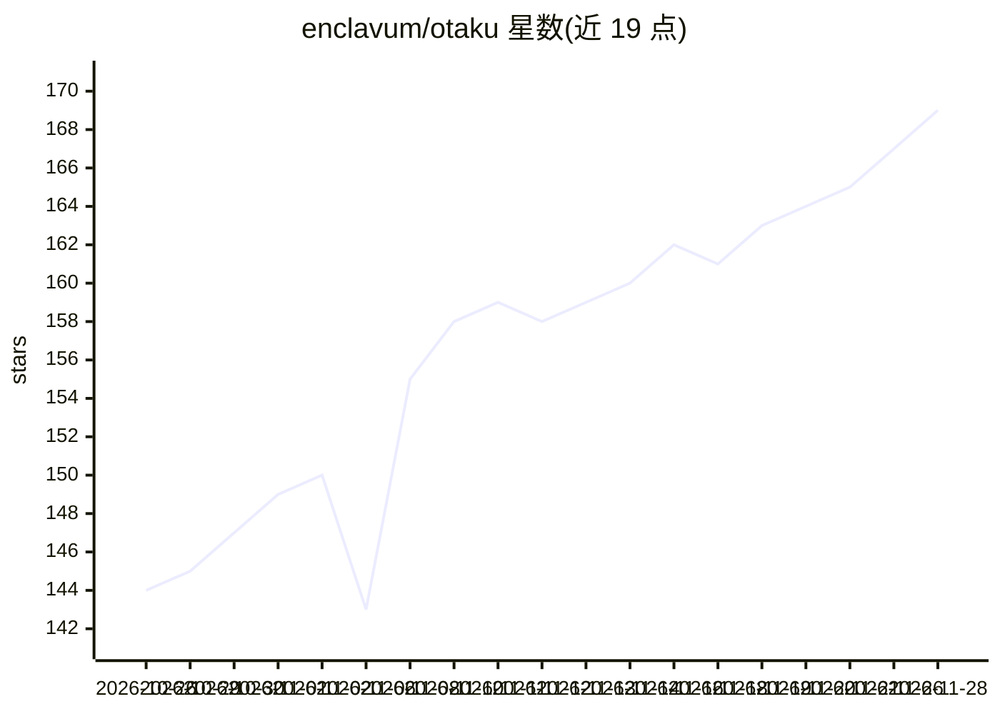

# enclavum/otaku

⭐ 169 · Python · AGPL-3.0 · 推送 2026-11-12 · [GitHub](https://github.com/enclavum/otaku) · [官网](https://otaku.sh) · 组织维护

**本地优先的角色扮演与创意写作 LLM 前端**

在个人电脑上运行的 LLM 前端，面向角色扮演与创意写作，提供终端与浏览器两种界面。核心机制围绕长故事上下文管理：首 20 与末 150 条消息原文保留，中间内容自动按场景生成摘要替换；支持钉选消息、章节切分、自动角色识别与角色日志。支持导入 SillyTavern 聊天与 PNG/JSON/CHARX 角色卡，模型工具包括问答选项、私人笔记、网页搜索与本地系统信息，支持语音输入与 D&D 骰子命令。需 Python 3.11+ 或 Docker，并需要本地模型后端或云 API key。

## 筛选速览

| 维度 | 判定 | 备注 |
|---|---|---|
| AI 角色 | `ai-native` | 本体是模型或模型工具 |
| 许可风险 | `viral` | AGPL-3.0 |
| 部署形态 | `self-host` | docker 或自建部署 |
| 模型依赖 | local-ok | 支持本地模型 |
| 硬件要求 | — | 无带数字的原话,不猜 |
| 安装摩擦 | `low` | 无编译、无系统依赖或容器化 |
| 成熟度 | — | 结构信号不足 |

## 能力要点

- 首 20/末 150 条原文保留 + 中段自动场景摘要的上下文压缩机制
- 自动角色识别，每个角色维护独立经历日志
- 支持 SillyTavern 聊天与 PNG/JSON/CHARX 角色卡导入
- 终端与 Web 界面共享同一套斜杠命令功能

## 适用场景

- 在本地电脑上进行长篇角色扮演故事，不受上下文膨胀困扰
- 把 SillyTavern 聊天和角色卡迁移过来继续玩
- 用 story 模式直接在记录里写小说并让模型续写
- D&D 跑团时用 /roll 掷骰并让模型担任 DM

## 场景标签

`聊天机器人` `AI 写作` · 领域:对话与助手

## 证据(README 行号)

> L1: # otaku — an LLM frontend for roleplay and creative writing
> L165: On first start, you choose a provider and a model. Otaku automatically detects local LLM

## 星数曲线

2026-10-26 144 → 2026-11-28 169（+25）

---
*卡片 v1 · prompt 1.4 · 生成 2026-11-27 · 置信度 high · 依据 README sha `fe9c24a0053c` · [字段定义](../../DATASET.md)*
