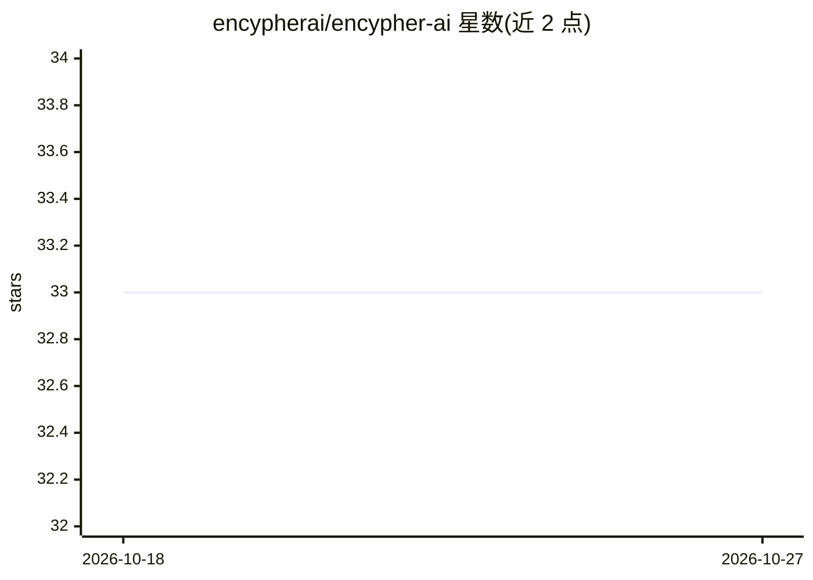

# encypherai/encypher-ai

⭐ 33 · Python · NOASSERTION · 推送 2026-10-01 · [GitHub](https://github.com/encypherai/encypher-ai) · [官网](https://encypherai.com) · 组织维护

**AI 生成文本的隐形元数据嵌入与提取库（来源追踪）**

Python 库，通过 Unicode variation selectors 在不改变可读性的前提下将元数据（模型信息、时间戳、自定义数据、C2PA 兼容清单）隐形嵌入 AI 生成的文本，并支持提取、Ed25519 数字签名验证与篡改检测。提供 CLI、流式与非流式 LLM 输出支持，及 OpenAI、Gemini、Anthropic、LiteLLM 的集成示例。采用分布式嵌入为主、末尾追加为兜底的多策略方案，硬绑定内容哈希仅覆盖纯文本。AGPL v3 许可，另提供商业许可与企业 API。

## 筛选速览

| 维度 | 判定 | 备注 |
|---|---|---|
| AI 角色 | `ai-ecosystem` | LLM/agent 周边工具 |
| 许可风险 | `none` | NOASSERTION |
| 部署形态 | `library` | 以包/库形式分发 |
| 模型依赖 | — | README 未给出锁定关系 |
| 硬件要求 | — | 无带数字的原话,不猜 |
| 安装摩擦 | `low` | 无编译、无系统依赖或容器化 |
| 成熟度 | — | 结构信号不足 |

## 能力要点

- Unicode variation selectors 隐形嵌入元数据，不影响可见文本
- Ed25519 COSE_Sign1 签名与 C2PA 兼容清单，支持篡改检测
- 支持流式与非流式 LLM 输出，附 CLI 与 Colab 示例
- 提供 OpenAI / Gemini / Anthropic / LiteLLM 集成

## 适用场景

- 为 LLM 应用输出嵌入来源与时间戳元数据以追踪生成模型
- 验证 AI 生成文本的完整性与签名、检测篡改
- 在流式 LLM 输出中实时嵌入 C2PA 风格清单

## 场景标签

 · 领域:AI 内容溯源/数据完整性

## 证据(README 行号)

> L16: A Python package for embedding and extracting metadata in text using Unicode variation selectors without affecting 
> L28: - **LLM integrations**: Ready-to-use integrations with OpenAI, Google Gemini, Anthropic Claude, and more
> L35: Encypher implements the Coalition for Content Provenance and Authenticity (C2PA) standard for plain-text environmen

## 星数曲线

2026-10-18 33 → 2026-10-27 33（+0）

---
*卡片 v1 · prompt 1.4 · 生成 2026-10-25 · 置信度 high · 依据 README sha `d56c5b7603f8` · [字段定义](../../DATASET.md)*
