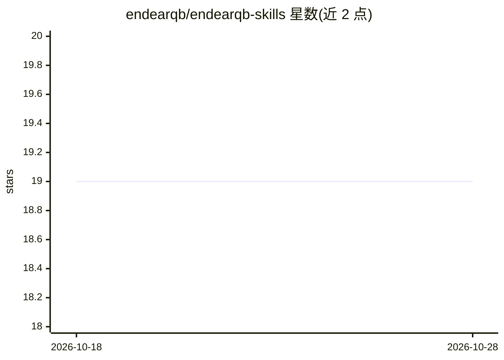

# endearqb/endearqb-skills

⭐ 19 · Python · MIT · 推送 2026-09-03 · [GitHub](https://github.com/endearqb/endearqb-skills) · 个人维护 · 中文 README

**可复用 Agent Skills 技能合集（10 个技能包）**

由 endearqb 维护的开源 Agent Skills 集合，收录 10 个技能包：实验报告写作、多 agent 编排框架、前端数据可视化、社群聊天记录分析、SVG 流程图生成、微信文件整理、编辑卡片截图、README First 项目初始化、去 AI 腔文本重写流水线、产品叙事 PPTX 生成。每个技能目录含 SKILL.md 说明、agents/ 元数据、references/ 参考资料及可选脚本与测试。使用方式为克隆仓库后将技能目录作为本地技能包接入 Agent Skills 工作流。MIT 许可，附中文 README。

## 筛选速览

| 维度 | 判定 | 备注 |
|---|---|---|
| AI 角色 | `ai-knowledge` | 知识聚合/清单类 |
| 许可风险 | `permissive` | MIT |
| 部署形态 | `None` |  |
| 模型依赖 | — | README 未给出锁定关系 |
| 硬件要求 | — | 无带数字的原话,不猜 |
| 安装摩擦 | `low` | 无编译、无系统依赖或容器化 |
| 成熟度 | — | 结构信号不足 |

## 能力要点

- 10 个技能包覆盖报告写作、多 agent 编排、可视化、流程图等
- 统一目录结构：SKILL.md + agents + references + scripts 等
- anti-ai-slop-swarm 汇总 10 个开源项目的去 AI 腔方法

## 适用场景

- 为 Agent Skills 工作流添加现成技能包
- 用多 agent 编排框架分解复杂任务
- 生成实验报告、SVG 流程图或产品叙事 PPTX

## 场景标签

`提示工程` · 领域:Agent 开发

## 证据(README 行号)

> L5: An open-source collection of reusable Agent Skills maintained in this repository.
> L9: This repository currently includes:

## 星数曲线

2026-10-18 19 → 2026-10-28 19（+0）

---
*卡片 v1 · prompt 1.4 · 生成 2026-10-28 · 置信度 high · 依据 README sha `9616cbf82d6a` · [字段定义](../../DATASET.md)*
