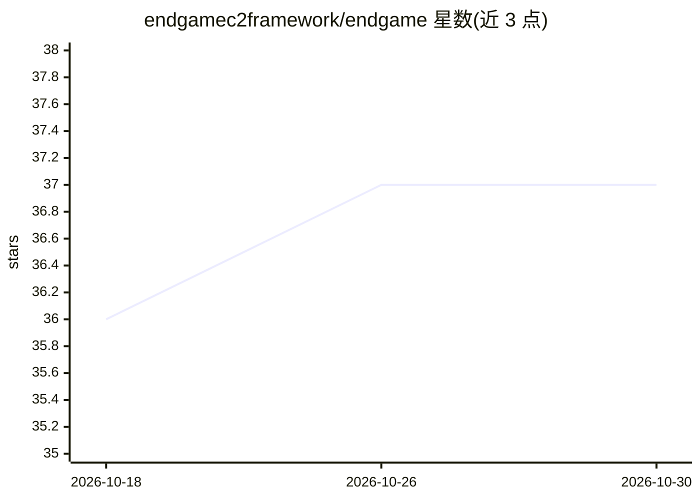

# endgamec2framework/endgame

⭐ 37 · C · NOASSERTION · 推送 2026-10-06 · [GitHub](https://github.com/endgamec2framework/endgame) · [官网](https://endgamec2framework.com) · 组织维护

**带 AI 控制台的红队 C2 框架：自然语言转 C2 命令**

面向授权红队行动与渗透测试的命令控制框架，包含 Go 多操作员团队服务器（mTLS/DNS canary）、Web GUI（杀伤链图、BOF 目录、插件市场）、以及 Go/Nim/Rust/C/C# 五种跨 Windows/Linux/macOS 的 Agent，覆盖 7 种传输、规避、横向移动等后渗透能力。AI Console 作为内置面板，将自然语言目标转为建议的 C2 命令、确认后派发执行并自动分析输出，可接 Ollama 本地或 Anthropic Claude API。通过 git clone 加 install.sh 安装。

## 筛选速览

| 维度 | 判定 | 备注 |
|---|---|---|
| AI 角色 | `ai-enhanced` | 去掉 AI 部分产品仍成立 |
| 许可风险 | `none` | NOASSERTION |
| 部署形态 | `desktop` | 安装包/桌面程序 |
| 模型依赖 | local-ok | 支持本地模型 |
| 硬件要求 | — | 无带数字的原话,不猜 |
| 安装摩擦 | `low` | 无编译、无系统依赖或容器化 |
| 成熟度 | — | 结构信号不足 |

## 能力要点

- 5 种语言实现的 Agent（Go/Nim/Rust/C/C#），7 种传输与完整规避套件
- AI Console：自然语言生成 C2 命令、确认后执行并自动分析结果
- AI 提供者无关：支持本地 Ollama 与 Anthropic Claude API
- 报告输出含 MITRE ATT&CK Navigator 层与多 SIEM 格式导出

## 适用场景

- 授权红队行动中用自然语言驱动 C2 操作
- 渗透测试中管理多平台植入体与后渗透任务
- 安全研究/检测覆盖率评估（DNS canary、SIEM 导出）

## 场景标签

`网络安全` · 领域:学习与行业

## 证据(README 行号)

> L3:  ENDGAME is a professional command and control framework built for authorized red team engagements, penetration test
> L27: ENDGAME's **AI Console** is a first-class feature that brings an AI co-pilot directly into the operator workflow. I
> L53: |**Provider agnostic**|Works with **Ollama** (local, offline) or **Anthropic Claude API** — whichever is configured

## 星数曲线

2026-10-18 36 → 2026-10-30 37（+1）

---
*卡片 v1 · prompt 1.4 · 生成 2026-10-25 · 置信度 high · 依据 README sha `154fa2b5868a` · [字段定义](../../DATASET.md)*
