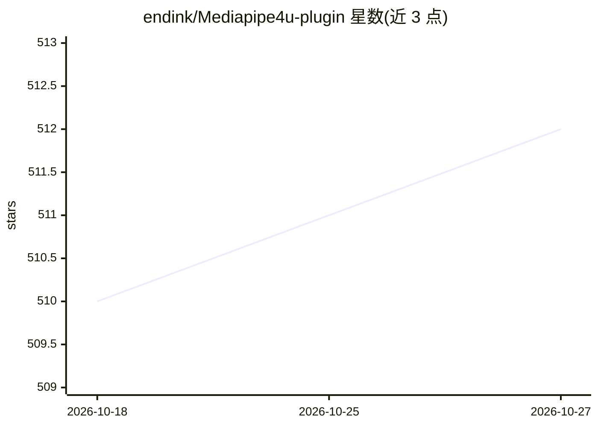

# endink/Mediapipe4u-plugin

⭐ 512 · 推送 2026-09-04 · [GitHub](https://github.com/endink/Mediapipe4u-plugin) · 个人维护 · 中文 README

**给 UE 开发者的 AI 能力插件：动作/表情捕捉、TTS、ASR、LLM 集成**

Unreal Engine 插件（支持 UE 5.1-5.8，Windows/Android，Linux 标注即将支持），在引擎内实时、离线提供身体与手指动作捕捉、面部表情捕捉（52 个 ARKit Blendshape、Live Link 兼容）、离线 TTS 与 ASR、语音唤醒、BVH 动画导出，并可通过 Ollama 接入 DeepSeek/LLaMA/Qwen 等大模型，LLMSpeechChatRuntime 组件组合 LLM+TTS+ASR 实现蓝图聊天机器人。动作捕捉基于 Google MediaPipe，可切换 NVIDIA Maxine (NvAR) 算法；Windows 下 MediaPipe 不支持 GPU 推理，使用 CPU 推理。以免费版+付费版形式分发，免费许可证文件定期发布。

## 筛选速览

| 维度 | 判定 | 备注 |
|---|---|---|
| AI 角色 | `ai-native` | 本体是模型或模型工具 |
| 许可风险 | `none` | — |
| 部署形态 | `None` |  |
| 模型依赖 | local-ok | 支持本地模型 |
| 硬件要求 | — | 无带数字的原话,不猜 |
| 安装摩擦 | `medium` | 含编译或系统依赖之一 |
| 成熟度 | — | 结构信号不足 |

## 能力要点

- 实时离线的身体/手指/表情捕捉，支持标准摄像头、视频文件、RTMP 流与 Android 设备作为捕捉源
- LLMSpeechChatRuntime 组件在蓝图中组合 LLM、TTS、ASR 实现聊天机器人，通过 Ollama 接入 DeepSeek/Qwen 等模型
- 多 TTS（Kokoro/Melo/F5-TTS 零样本克隆）与多 ASR（FunASR/FireRedASR/SenseVoice/whisper.cpp 等）模型支持
- 无需外部程序，全部功能在 Unreal Engine 内完成

## 适用场景

- 用普通摄像头驱动 UE/Metahuman 角色的动作和面部表情
- 在 UE 项目中实现离线实时语音对话机器人
- 将捕捉结果导出为 BVH 动画数据

## 场景标签

`语音 Agent` `语音合成` `语音识别` · 领域:对话与助手

## 证据(README 行号)

> L28: **MediaPipe4U** provides a suite of components and tools that let you quickly apply artificial intelligence (AI) an
> L84: - Motion Capture
> L105:  - Ollama support

## 星数曲线

2026-10-18 510 → 2026-10-27 512（+2）

---
*卡片 v1 · prompt 1.4 · 生成 2026-10-22 · 置信度 high · 依据 README sha `2fdbd50379e7` · [字段定义](../../DATASET.md)*
